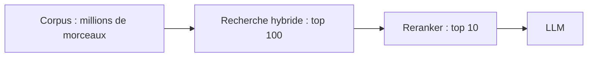

## Bi-encoder et cross-encoder {#encodeurs}

Deux façons de mesurer si un document répond à une question.

| | Bi-encoder | Cross-encoder |
|---|---|---|
| Lecture | Question et document séparément | Question et document ensemble |
| Précalcul | Oui, à l'indexation | Impossible |
| Vitesse | Très rapide | Lent |
| Précision | Bonne | Meilleure |
| Usage | Première recherche | Second tri |

:::pourquoi
Le bi-encoder résume chaque texte seul, en un vecteur.
Le cross-encoder voit les deux textes côte à côte.
Il repère qu'un document parle du bon sujet sans répondre à la question.
:::

En 2019, Nogueira et Cho appliquent BERT en cross-encoder pour retrier des passages. Le gain est net sur le benchmark MS MARCO.

:::pourquoi
C'est le moment où le reranking neuronal devient la norme.
L'idée n'a pas changé depuis : un second tri plus fin sur peu de candidats.
:::

**ColBERT** (2020) est un compromis : un vecteur par token, précalculé, comparé token à token.

:::pourquoi
Plus de détail qu'un vecteur par texte.
Précalculable, contrairement au cross-encoder.
Le prix : beaucoup plus de stockage.
:::

## Latence contre précision {#compromis}

On organise la recherche en **entonnoir**.

Étape 1 : large et rapide. Elle vise le **rappel** : ne rien rater.

Étape 2 : étroite et lente. Elle vise la **précision** : bien trier.

:::pourquoi
Le reranker trie. Il ne cherche pas.
Un document absent des candidats est perdu pour de bon.
:::

Le nombre de candidats est le réglage principal.

:::pourquoi
Plus de candidats, plus de chances d'avoir le bon.
Mais le reranker fait un passage par candidat.
Quatre fois plus de candidats, environ quatre fois plus de temps de reranking.
:::

Surveille la latence p95, pas la moyenne.

:::pourquoi
La moyenne cache les requêtes lentes.
La p95 dit ce que vivent les cas difficiles.
:::

## À retenir

- Bi-encoder : rapide, précalculé, pour chercher.
- Cross-encoder : précis, coûteux, pour retrier.
- Entonnoir : rappel d'abord, précision ensuite.
- Le reranker ne repêche jamais un document absent.
