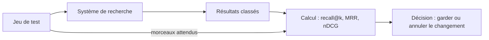

## recall@k, MRR, nDCG {#metriques}

Sans mesure, on règle à l'aveugle.

Trois mesures, trois questions.

| Mesure | Question | Usage |
|---|---|---|
| recall@k | Les bons documents sont-ils dans les k premiers ? | Première étape d'un RAG |
| MRR | À quel rang arrive le premier bon document ? | Une seule bonne réponse |
| nDCG | Les plus pertinents sont-ils tout en haut ? | Pertinence graduée |

**recall@k** : pertinents trouvés dans les k premiers, divisé par pertinents existants.

:::pourquoi
Le LLM ne voit que les k morceaux qu'on lui donne.
Ce qui est au rang k+1 n'existe pas pour lui.
Anthropic mesure Contextual Retrieval en échecs dans les 20 premiers : 1 moins le recall@20.
:::

**MRR** : moyenne de 1/rang du premier bon résultat.

:::pourquoi
Rang 1 vaut 1. Rang 2 vaut 0,5. Rang 10 vaut 0,1.
Il punit fort un bon résultat qui n'arrive pas en tête.
:::

**nDCG** : chaque document a une note de pertinence. Son gain diminue avec le rang. On divise par le score d'un ordre parfait.

:::pourquoi
Certains documents sont très pertinents, d'autres un peu.
nDCG récompense les meilleurs placés en haut.
1 veut dire ordre parfait.
:::

## Construire un jeu de test {#jeu-de-test}

Un jeu de test : des questions, et pour chacune, les morceaux qui y répondent.

:::pourquoi
Pour mesurer ce qu'on a raté, il faut savoir ce qu'on aurait dû trouver.
:::

D'où viennent les questions ?

- De vrais utilisateurs : les meilleures, mais il faut les annoter.
- Générées par un LLM à partir des morceaux : rapides, mais trop faciles.

:::pourquoi
Un LLM qui lit un morceau reprend ses mots.
La recherche par mots-clés les trouve trop bien.
Le score devient flatteur.
:::

Couvre les cas difficiles :

- identifiants et codes ;
- synonymes et reformulations ;
- réponses réparties sur plusieurs documents ;
- questions **sans** réponse dans le corpus.

:::pourquoi
Chaque cas teste une faiblesse différente.
Un jeu fait de cas faciles affiche 95 % et ne t'apprend rien.
:::

Commence petit : 50 à 100 questions. Agrandis au fil des échecs réels.

Garde une partie du jeu de côté. Ne règle jamais sur elle.

:::pourquoi
À force de régler sur les mêmes questions, on optimise pour elles.
La partie mise de côté dit si le gain est réel.
:::

Relance la mesure à chaque changement : découpage, modèle, filtres, reranker.

## À retenir

- recall@k pour la première étape. MRR ou nDCG pour l'ordre.
- Un jeu de test : questions et morceaux attendus.
- Questions générées par LLM : trop faciles seules.
- Une partie du jeu mise de côté, jamais utilisée pour régler.
