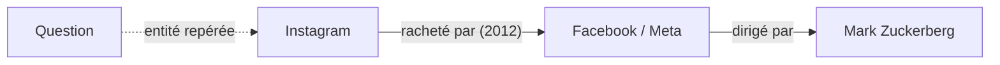
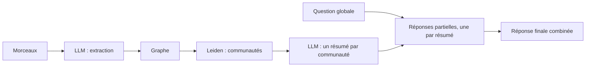

## Entités et relations {#entites}

Le RAG classique stocke des morceaux isolés. GraphRAG stocke aussi **les liens** entre eux.

Un LLM lit chaque morceau et en extrait :

- des **entités** : personnes, organisations, lieux, produits ;
- des **relations** : « Facebook — a racheté — Instagram ».

:::pourquoi
Un index de vecteurs sait dire « ce morceau ressemble à la question ».
Il ne sait pas dire « ce morceau est lié à celui-là ».
Le graphe garde ce lien.
:::

Le plus dur : reconnaître qu'un même acteur porte plusieurs noms.

:::pourquoi
« M. Dupont », « Jean Dupont », « le PDG » : trois nœuds au lieu d'un.
Les relations se dispersent, le parcours rate des liens.
C'est la résolution d'entités.
:::

## Parcours multi-sauts {#multi-sauts}

Certaines questions demandent de relier deux faits.

« Qui dirige l'entreprise qui a racheté Instagram ? »

:::pourquoi
Le morceau sur le rachat ressemble à la question.
Le morceau sur le dirigeant, non.
La recherche vectorielle trouve le premier et rate le second.
Le graphe suit l'arête et trouve les deux.
:::

On limite le parcours à 1 ou 2 sauts.

:::pourquoi
À chaque saut, le nombre de voisins est multiplié.
Au-delà, le contexte se remplit de liens lointains.
:::

## Résumés de communautés {#communautes}

En 2024, Microsoft publie GraphRAG pour une autre famille de questions : les questions **globales**.

« Quels sont les grands thèmes de ce corpus ? »

:::pourquoi
Aucun passage ne contient la réponse.
Elle demande une vue d'ensemble.
Le RAG vectoriel n'a rien de ressemblant à retrouver.
:::

La méthode :

:::pourquoi
Une communauté est un groupe d'entités très liées : souvent un thème.
Résumer chaque thème à l'avance prépare la vue d'ensemble.
À la question, on combine les résumés au lieu de relire le corpus.
:::

## Quand ça ne vaut pas le coût {#cout}

GraphRAG coûte cher à construire.

:::pourquoi
Un appel de LLM par morceau pour extraire.
Un appel par communauté pour résumer.
Tout est à refaire quand le corpus change beaucoup.
:::

Microsoft le reconnaît lui-même. En novembre 2024, il publie **LazyGraphRAG** : indexation au même coût qu'un RAG vectoriel, soit 0,1 % de GraphRAG.

:::pourquoi
LazyGraphRAG ne résume rien à l'avance.
Il fait travailler le LLM au moment de la question.
Le coût se déplace de l'indexation vers la requête.
:::

Règle de décision :

| Type de question | Exemple | Outil |
|---|---|---|
| Locale | « Comment changer mon mot de passe ? » | RAG hybride + reranking |
| Multi-sauts | « Qui dirige l'entreprise qui a racheté X ? » | Graphe, 1 à 2 sauts |
| Globale | « Quels sont les grands thèmes ? » | Résumés de communautés |

:::pourquoi
Selon Microsoft, le RAG vectoriel excelle quand la réponse ressemble à la question.
Commence par lui. Mesure.
Ajoute un graphe seulement si des questions multi-sauts ou globales échouent.
:::

## À retenir

- Un graphe stocke les liens que les vecteurs ignorent.
- Multi-sauts : on suit les relations, 1 ou 2 sauts.
- Questions globales : résumés de communautés, combinés.
- Coût d'indexation élevé. Commence simple, ajoute un graphe si la mesure le justifie.
