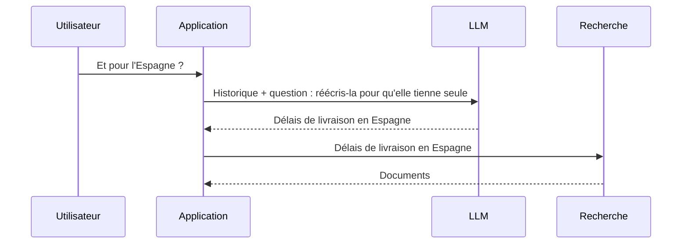
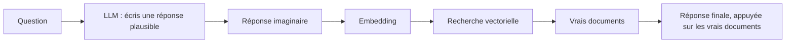

## Reformulation {#reformulation}

La question de l'utilisateur n'est pas toujours une bonne requête de recherche.

Elle dépend de l'historique. Elle utilise ses mots, pas ceux des documents.

:::pourquoi
La recherche ne voit pas l'historique.
« Et pour l'Espagne ? » seul ne trouve rien d'utile.
:::

On peut générer plusieurs reformulations et fusionner les résultats.

:::pourquoi
Chaque formulation attrape d'autres documents.
On couvre plus de vocabulaire.
Le prix : plusieurs recherches.
:::

Développe les sigles. Garde aussi la forme courte.

:::pourquoi
Le document peut utiliser l'une ou l'autre.
BM25 ne fait pas le lien seul.
:::

## Décomposition {#decomposition}

Une question complexe cache plusieurs questions simples.

« Compare 2023 et 2024 » → « Règles 2023 ? » + « Règles 2024 ? »

:::pourquoi
Une seule recherche favorise un des deux sujets.
Une recherche par sous-question trouve chaque morceau.
:::

En 2022, Self-Ask mesure un **écart de composition** : le modèle répond aux sous-questions, mais rate la question combinée.

:::pourquoi
Combiner deux faits en silence est difficile.
Écrire les étapes rend chaque fait explicite.
:::

Ne découpe pas les questions simples.

:::pourquoi
Chaque sous-question coûte un appel et une recherche.
:::

## HyDE {#hyde}

HyDE (2022) inverse le problème. On ne cherche pas avec la question. On cherche avec une **réponse imaginée**.

:::pourquoi
Une question ne ressemble pas à un paragraphe de réponse.
Une réponse imaginée, si.
Même fausse, elle a le bon vocabulaire et la bonne forme.
:::

La réponse imaginaire n'est **jamais** montrée.

:::pourquoi
Elle est écrite sans source.
Elle sert de sonde, pas de réponse.
:::

## À retenir

- Réécris la question pour qu'elle tienne seule.
- Plusieurs formulations, résultats fusionnés.
- Découpe les questions composées, pas les simples.
- HyDE : chercher avec une réponse imaginée, jamais la montrer.
