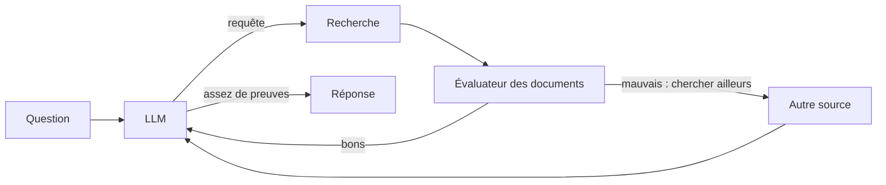

## Boucler {#boucler}

Un RAG simple fait : chercher, puis répondre. Une fois.

Un RAG en plusieurs étapes fait : chercher, lire, décider, chercher encore.

:::pourquoi
Ce qu'on lit change ce qu'il faut chercher.
Le premier document révèle souvent le nom à chercher ensuite.
:::

Plusieurs familles d'approches :

| Approche | Idée |
|---|---|
| IRCoT (2022) | Alterner une étape de raisonnement et une recherche |
| Self-RAG (2023) | Le modèle décide s'il faut chercher, et juge s'il est soutenu |
| CRAG (2024) | Un évaluateur note les documents, et cherche ailleurs s'ils sont mauvais |
| RAG agentique | La recherche est un outil que le modèle appelle librement |

:::pourquoi
Toutes partagent une idée : la recherche n'est plus une étape fixe.
Elle devient une décision prise en cours de route.
:::

## Savoir s'arrêter {#arreter}

Une boucle sans fin coûte cher. Et elle n'améliore pas la réponse.

Arrête quand :

- chaque partie de la question a une preuve ;
- **ou** le maximum de tours est atteint ;
- **ou** les recherches ne ramènent plus rien de nouveau.

:::pourquoi
Le modèle peut toujours trouver une raison de chercher encore.
La limite protège le budget et le temps de réponse.
Des résultats identiques signalent qu'on tourne en rond.
:::

Ne garde pas tout ce que les étapes ont ramené.

:::pourquoi
Chaque étape ajoute des passages.
Doublons et distracteurs font baisser la qualité.
Déduplique. Garde ce qui sert la réponse.
:::

Si la boucle s'arrête sans preuve suffisante, on ne devine pas. On s'abstient.

:::pourquoi
Une boucle qui échoue est une information utile.
Elle dit que le corpus ne contient pas la réponse.
C'est l'objet de la rubrique Abstention.
:::

## À retenir

- Ce qu'on lit dit quoi chercher ensuite.
- La recherche devient une décision, prise par le modèle ou par un évaluateur.
- Arrêt : preuves complètes, maximum de tours, ou plus rien de neuf.
- Pas de preuve à la fin : on s'abstient.
