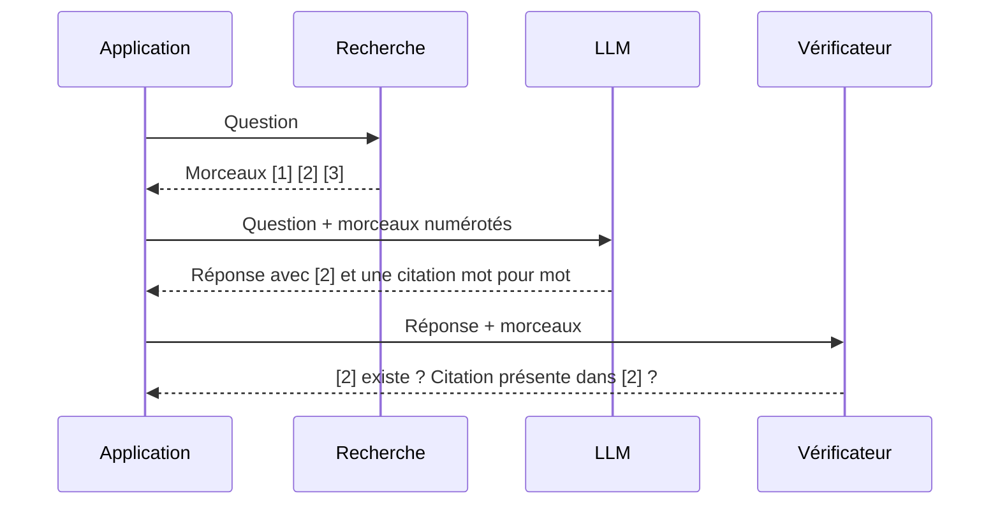

## Citer ses sources {#citer}

Une réponse sans source ne se vérifie pas.

Printemps 2023. Dans l'affaire *Mata v. Avianca*, un avocat new-yorkais dépose un mémoire. Il cite des jurisprudences trouvées avec ChatGPT.

Aucune n'existe.

Il avait pourtant demandé à ChatGPT si elles étaient réelles. ChatGPT avait dit oui.

:::pourquoi
Le modèle produit du texte probable.
« Oui, cette affaire existe » est une réponse probable.
Le juge sanctionne les avocats. La faute était de ne pas avoir vérifié.
:::

La citation doit être vérifiable **par ton code**, pas par le modèle.

:::pourquoi
Les identifiants viennent de ton application. Le modèle ne peut pas en inventer de valides.
Une citation mot pour mot se vérifie par simple recherche de texte.
:::

Pour un long document, demande d'abord les passages exacts, puis l'analyse.

:::pourquoi
C'est une recommandation d'Anthropic.
Extraire d'abord force le modèle à s'appuyer sur le texte réel.
S'il ne trouve rien, il le dit au lieu d'inventer.
:::

## Vérifier le support {#support}

Citer ne suffit pas. Air Canada citait la bonne page. La page disait le contraire.

:::pourquoi
La citation dit d'où vient l'affirmation.
Elle ne dit pas si la source la soutient.
:::

En 2024, Stanford teste des outils juridiques à base de RAG. Certains sont vendus « sans hallucination ». Ils se trompent dans plus d'une requête sur six.

:::pourquoi
Le RAG réduit les hallucinations, il ne les supprime pas.
Le modèle peut mal lire, mal combiner, ou compléter de mémoire.
Il faut contrôler la sortie, pas seulement l'entrée.
:::

La méthode : découper la réponse en affirmations, puis juger chacune.

Exemple fictif, une boutique en ligne :

| Affirmation | Source | Verdict |
|---|---|---|
| « Retour gratuit sous 60 jours » | CGV : « retour gratuit sous 30 jours » | Contredite |
| « Le remboursement se fait sur le moyen de paiement d'origine » | CGV, article 7 | Soutenue |
| « Les soldes sont exclus des retours » | Aucune | Absente |

:::pourquoi
Une réponse globale mélange vrai et faux.
Un verdict par affirmation montre exactement ce qui pose problème.
On retire ou on signale ce qui n'est pas soutenu.
:::

La **fidélité** est la part d'affirmations soutenues par le contexte.

:::pourquoi
Elle ne juge pas la vérité du monde. Elle juge le lien avec les sources.
Une réponse vraie mais sans source n'est pas fidèle.
:::

## À retenir

- Le modèle ne vérifie pas ses propres citations.
- Identifiants fournis par l'application, citations mot pour mot vérifiées par le code.
- Citer n'est pas soutenir. On juge chaque affirmation.
- Le RAG réduit les hallucinations. Il ne les supprime pas.
