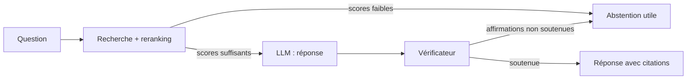

## Seuils de confiance {#seuils}

Parfois, la bonne réponse est de ne pas répondre.

Mais il faut le décider sur des **signaux**, pas sur une impression.

| Signal | Ce qu'il indique |
|---|---|
| Score du meilleur document | Le corpus contient-il la réponse ? |
| Score du reranker | Les passages répondent-ils vraiment ? |
| Verdict du vérificateur | La réponse est-elle soutenue ? |
| Cohérence entre plusieurs réponses | Le modèle est-il stable ? (rubrique suivante) |

:::pourquoi
Aucun signal n'est parfait seul.
Ensemble, ils disent si la réponse repose sur du solide.
:::

La confiance exprimée en mots (« sûr à 95 % ») est souvent mal calibrée.

:::pourquoi
C'est du texte généré, pas une mesure.
Préfère des scores calculés, et vérifie-les sur ton jeu de test.
:::

Le seuil se règle sur des questions **sans réponse**, et selon le coût d'une erreur.

:::pourquoi
Trop bas : on répond à tout et on se trompe.
Trop haut : on ne répond plus à rien.
En médecine, on accepte plus d'abstentions qu'en cuisine.
:::

## Dire « je ne sais pas » {#je-ne-sais-pas}

Septembre 2025. OpenAI publie *Why language models hallucinate*.

Sa thèse : on entraîne et on note les modèles comme des élèves à un examen sans points négatifs.

:::pourquoi
Deviner une date d'anniversaire : une chance sur 365 de marquer.
« Je ne sais pas » : zéro, toujours.
Un modèle optimisé pour ces scores apprend à deviner.
:::

L'article compare deux modèles. L'un s'abstient sur 52 % des questions. L'autre sur 1 %. Le second a une précision un peu meilleure. Mais beaucoup plus d'erreurs.

:::pourquoi
Répondre à tout gagne quelques bonnes réponses.
Et accumule les fausses.
Ne mesure jamais la précision sans compter les erreurs.
:::

Autorise explicitement l'abstention dans le prompt.

:::pourquoi
Anthropic la présente comme la technique de base contre les inventions.
Sans permission, le modèle cherche à répondre coûte que coûte.
:::

Une bonne abstention aide quand même :

- ce qui est sûr, avec sa source ;
- ce qui manque ;
- une suite : un lien, un humain, une question de précision.

:::pourquoi
Le chatbot d'Air Canada avait la page officielle sous la main.
Il pouvait dire : « Je ne suis pas sûr. Voici la page officielle sur les tarifs de deuil. »
Une réponse moins séduisante. Mais pas une règle inventée.
:::

## À retenir

- On s'abstient sur des signaux mesurés, pas sur une impression.
- Le seuil se règle sur des questions sans réponse, selon le coût d'une erreur.
- Les évaluations qui ignorent les erreurs poussent à deviner.
- Autorise le « je ne sais pas », et rends-le utile.
