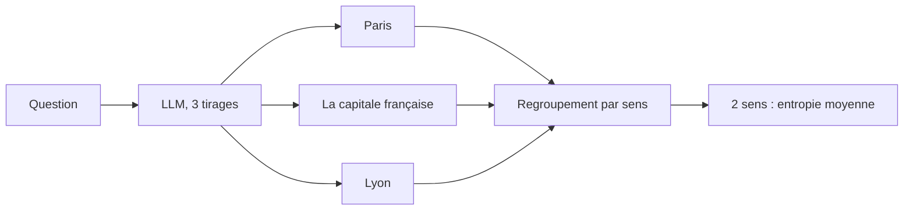
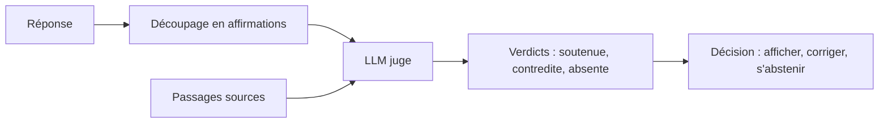

## Cohérence {#coherence}

Idée simple : pose la même question plusieurs fois.

Un fait connu revient. Un fait inventé change.

:::pourquoi
Quand le modèle sait, la réponse la plus probable domine.
Quand il improvise, plusieurs réponses se valent, et le tirage varie.
:::

**SelfCheckGPT** (2023) compare plusieurs tirages entre eux. Pas besoin de source externe.

**L'entropie sémantique** (Nature, 2024) regroupe les tirages **par sens**. Beaucoup de sens différents : risque d'invention.

:::pourquoi
« Paris » et « la capitale française » disent la même chose.
Compter les textes différents gonflerait l'incertitude.
Compter les sens différents mesure la vraie hésitation.
:::

Limite : une erreur apprise est répétée avec constance.

:::pourquoi
Tous les tirages sont d'accord, et tous ont tort.
La cohérence détecte l'improvisation, pas l'erreur apprise.
:::

Coût : plusieurs générations par question.

## Juge {#juge}

Un second modèle vérifie la réponse contre les sources.

:::pourquoi
Comparer une affirmation à un passage est une tâche simple.
Bien plus simple que produire la réponse.
Un modèle plus petit peut souvent la faire.
:::

**FActScore** (2023) formalise l'idée : des faits atomiques, vérifiés un par un.

:::pourquoi
Une note globale cache une erreur isolée.
Un verdict par fait la montre.
:::

Le juge doit recevoir les sources.

:::pourquoi
Sans elles, il vérifie de mémoire.
Il peut halluciner à son tour.
:::

Le juge se trompe aussi. On mesure son accord avec des humains.

:::pourquoi
Un juge non calibré donne une fausse sécurité.
C'est le sujet de l'étape 7.
:::

Où placer la vérification ?

| Cas | Stratégie |
|---|---|
| Sujet à risque : santé, droit, argent | Vérifier avant d'afficher |
| Question courante | Afficher, vérifier un échantillon après coup |

## À retenir

- Cohérence : un fait qui varie entre tirages est suspect.
- On compare des sens, pas des mots.
- La cohérence rate les erreurs apprises. Le juge avec sources les attrape.
- Le juge se calibre contre des humains.
