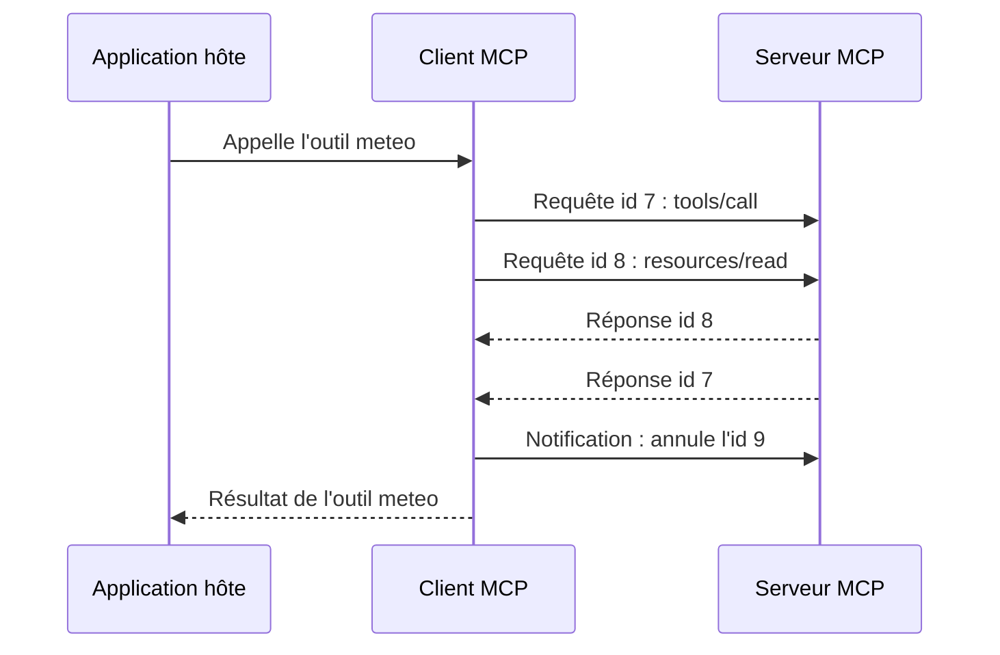

## Requête et réponse {#requete}

MCP parle **JSON-RPC 2.0**. Un format simple pour appeler une fonction à distance.

```json
{ "jsonrpc": "2.0", "id": 7, "method": "tools/call",
  "params": { "name": "meteo", "arguments": { "ville": "Lyon" } } }
```

```json
{ "jsonrpc": "2.0", "id": 7, "result": { "content": [ { "type": "text", "text": "12 °C" } ] } }
```

Même id dans la question et la réponse.

:::pourquoi
Plusieurs requêtes peuvent être en vol en même temps.
Les réponses peuvent revenir dans le désordre.
L'id dit à quelle question répond chaque réponse.
:::

Une réponse contient `result` **ou** `error`. Jamais les deux.

MCP ajoute deux règles : l'id n'est jamais `null`, et il est unique parmi les requêtes en cours.

:::pourquoi
Un id nul ou réutilisé rendrait la correspondance ambiguë.
:::

JSON-RPC ne dit rien du transport.

:::pourquoi
Il décrit les messages, pas le tuyau.
MCP peut donc passer par l'entrée standard ou par HTTP.
:::

## Notification {#notification}

Une notification est un message **sans id**. On n'y répond pas.

```json
{ "jsonrpc": "2.0", "method": "notifications/tools/list_changed" }
```

:::pourquoi
Certains messages informent sans rien demander.
« La liste des outils a changé. » « Annule la requête 7. »
Attendre une réponse serait inutile.
:::

## Erreurs {#erreurs}

Les codes standard de JSON-RPC :

| Code | Signification | Exemple |
|---|---|---|
| -32700 | Erreur d'analyse | JSON illisible |
| -32600 | Requête invalide | Il manque `method` |
| -32601 | Méthode introuvable | `tools/cal` au lieu de `tools/call` |
| -32602 | Paramètres invalides | Outil inconnu, argument manquant |
| -32603 | Erreur interne | Exception côté serveur |

MCP réserve ses propres codes, par exemple -32022 pour une version de protocole non supportée.

:::pourquoi
Un code entier se teste dans le programme.
Un message en texte libre ne se teste pas de façon fiable.
:::

Ne mets jamais de secret dans `message` ou `data`.

:::pourquoi
L'erreur remonte au client, et souvent au modèle.
Un chemin de fichier ou une clé dans une erreur, c'est une fuite.
:::



## À retenir

- Requête : id, method, params. Réponse : même id, result ou error.
- Notification : pas d'id, pas de réponse.
- Les codes d'erreur se testent. Les messages ne contiennent pas de secret.
- JSON-RPC décrit les messages, pas le transport.
