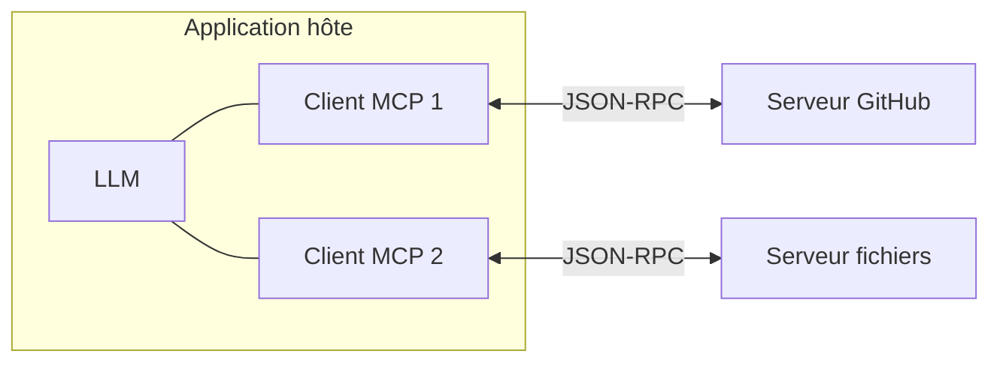
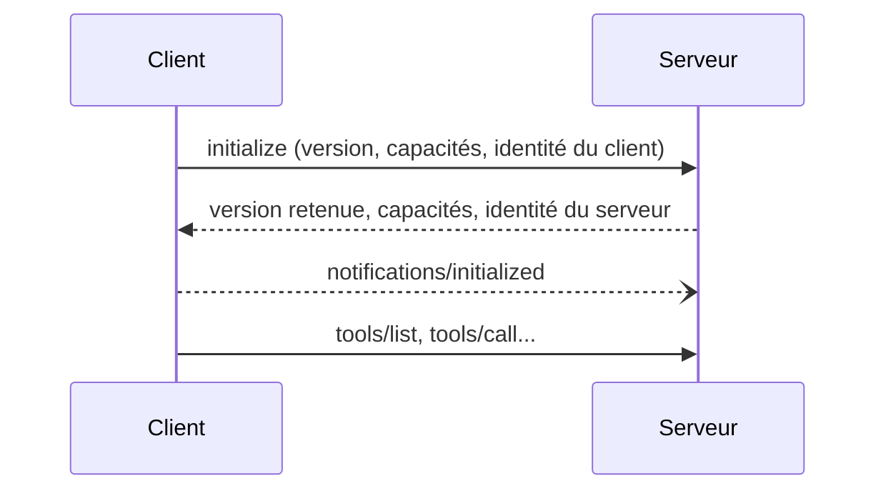

## Pourquoi un protocole {#versions}

Novembre 2024. Anthropic publie le **Model Context Protocol**.

Le problème : chaque application d'IA codait ses propres connecteurs vers chaque outil.

:::pourquoi
10 applications, 20 outils : 200 intégrations.
Avec un protocole commun : 10 clients et 20 serveurs.
Chaque nouveau serveur marche avec toutes les applications.
:::

En décembre 2025, Anthropic donne MCP à l'Agentic AI Foundation, sous l'égide de la Linux Foundation. Anthropic, Block et OpenAI la cofondent.

:::pourquoi
Un standard porté par un seul acteur inquiète ses concurrents.
Une fondation neutre rassure ceux qui l'adoptent.
:::

Trois rôles :

| Rôle | Exemple | Fait quoi |
|---|---|---|
| Hôte | Claude Desktop, un IDE | Contient le modèle et l'interface |
| Client | Un par serveur, dans l'hôte | Parle le protocole |
| Serveur | GitHub, fichiers, base de données | Expose outils, ressources, prompts |

### Les versions évoluent

Jusqu'à la révision **2025-11-25**, une connexion commence par une poignée de main.

:::pourquoi
Les deux côtés s'accordent sur la version et les fonctions disponibles.
Si le client ne supporte pas la version proposée, il se déconnecte.
Avant cet accord, seuls les pings sont permis.
:::

La révision **2026-07-28** supprime cette poignée de main. Le protocole devient **sans état**.

Chaque requête porte sa version et les capacités du client dans `_meta`. Une version non supportée renvoie l'erreur -32022, avec la liste des versions acceptées.

:::pourquoi
Sans session, n'importe quelle instance du serveur traite n'importe quelle requête.
Un répartiteur de charge peut envoyer où il veut.
Un redémarrage ne casse rien.
L'état nécessaire passe par des identifiants explicites : un numéro de panier, de transaction.
:::

Beaucoup de serveurs parlent encore l'ancienne version. Un client peut parler les deux.

## tools/list et tools/call {#outils}

`tools/list` : le client découvre les outils.

`tools/call` : le client en appelle un, avec ses arguments.

Le résultat contient `content` (texte, image…), éventuellement `structuredContent` validé par le schéma de sortie, et `isError`.

Deux sortes d'erreurs :

| Erreur | Exemple | Forme | Va au modèle ? |
|---|---|---|---|
| Protocole | Outil inconnu, requête mal formée | Erreur JSON-RPC | Rarement utile |
| Exécution | Date dans le passé, API indisponible | Résultat avec `isError: true` | Oui, pour qu'il se corrige |

:::pourquoi
« La date doit être dans le futur » est une information exploitable.
Le modèle peut corriger l'argument et réessayer.
Une erreur de protocole signale un bug du client, pas une erreur du modèle.
:::

Les **annotations** (`readOnlyHint`, `destructiveHint`…) sont des indications. Pas des garanties.

:::pourquoi
C'est le serveur qui les déclare.
Un serveur malveillant peut mentir.
La spécification exige de les traiter comme non fiables, sauf serveur de confiance.
:::

Renvoie les outils dans un ordre stable.

:::pourquoi
La liste des outils entre dans le prompt.
Un ordre stable permet au cache de prompt de la réutiliser.
:::

## Ressources et prompts {#ressources}

MCP a trois primitives. Chacune a son décideur.

| Primitive | Qui décide | Exemple |
|---|---|---|
| Outil | Le modèle | Créer une issue GitHub |
| Ressource | L'application | Le fichier README du projet |
| Prompt | L'utilisateur | La commande /revue-de-code |

:::pourquoi
Le modèle ne devrait pas tout décider.
L'application choisit le contexte. L'utilisateur choisit le gabarit de tâche.
Le modèle agit dans ce cadre.
:::

Une **ressource** est identifiée par une URI. On la liste, on la lit, on peut s'abonner à ses changements.

Un **prompt** est un gabarit de messages, avec des arguments. Il apparaît souvent comme une commande slash.

Un serveur de fichiers doit empêcher la traversée de répertoire.

:::pourquoi
« ../../.ssh/id_rsa » sort du dossier autorisé.
La spécification l'interdit explicitement.
:::

## stdio et HTTP {#transports}

Deux transports standard.

**stdio** : le client lance le serveur comme sous-processus. Ils parlent par l'entrée et la sortie standard.

- Un message JSON par ligne. Pas de retour à la ligne à l'intérieur.
- `stdout` : uniquement des messages MCP.
- `stderr` : les logs.
- Arrêt : le client ferme l'entrée standard, attend, puis force l'arrêt si besoin.

:::pourquoi
Le client lit stdout ligne par ligne.
Un simple print() de debug y casse la communication.
C'est le bug numéro un des premiers serveurs.
:::

**Streamable HTTP** : le serveur est un service web, avec un seul point d'entrée. Il peut répondre en flux (SSE). Il remplace l'ancien transport HTTP+SSE de 2024.

En local, la spécification exige de vérifier l'en-tête `Origin`, et recommande d'écouter sur 127.0.0.1 et d'authentifier.

:::pourquoi
Une page web peut viser un serveur local par rebinding DNS.
Vérifier Origin bloque l'attaque.
Écouter sur 0.0.0.0 expose le serveur à tout le réseau.
:::

Identifiants : en HTTP, le cadre d'autorisation OAuth de MCP. En stdio, l'environnement.

## À retenir

- MCP transforme N × M intégrations en N + M.
- Jusqu'en 2025-11-25 : poignée de main initialize. Depuis 2026-07-28 : sans état, version dans chaque requête.
- Erreur d'exécution : `isError`, pour que le modèle se corrige. Erreur de protocole : JSON-RPC.
- Annotations non fiables. stdout réservé aux messages. Origin vérifié en HTTP.
