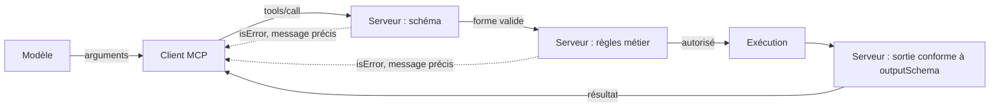

## JSON Schema {#json-schema}

Un outil MCP décrit ses arguments avec **JSON Schema**. Par défaut, la version 2020-12.

```json
{
  "type": "object",
  "properties": {
    "date_depart": { "type": "string", "format": "date",
                     "description": "Date de départ, AAAA-MM-JJ, dans le futur" },
    "priorite": { "type": "string", "enum": ["basse", "normale", "haute"] },
    "passagers": { "type": "integer", "minimum": 1, "maximum": 9 }
  },
  "required": ["date_depart", "passagers"],
  "additionalProperties": false
}
```

Les mots-clés qui comptent :

| Mot-clé | Rôle |
|---|---|
| `required` | Champs obligatoires |
| `enum` | Liste fermée de valeurs |
| `minimum`, `maximum`, `pattern` | Bornes et format |
| `additionalProperties: false` | Refuse tout champ non déclaré |
| `description` | Ce que le modèle lit pour remplir le champ |

:::pourquoi
Un schéma sert deux lecteurs.
Le modèle le lit pour savoir quoi écrire.
Le validateur le lit pour refuser ce qui ne va pas.
:::

Un outil sans paramètre : `{"type": "object", "additionalProperties": false}`.

:::pourquoi
La spécification le recommande.
Il accepte seulement un objet vide.
:::

Ne résous jamais un `$ref` distant automatiquement.

:::pourquoi
Ce serait une requête réseau déclenchée par un schéma.
Un schéma piégé pourrait viser un service interne.
:::

Avec **Pydantic**, une classe Python produit le schéma (`model_json_schema()`) et valide les arguments. `extra="forbid"` donne `additionalProperties: false`.

:::pourquoi
Une seule définition pour décrire et pour valider.
Elles ne peuvent plus diverger.
:::

## Valider entrées et sorties {#valider}

Le serveur valide **toujours** ses entrées. Même si le client l'a déjà fait.



:::pourquoi
Le serveur ne contrôle pas ses clients.
La spécification exige qu'il valide tout ce qui entre.
:::

Deux couches :

1. **Le schéma** : types, champs, bornes.
2. **Les règles métier** : date dans le futur, ressource appartenant à l'utilisateur, montant sous le plafond.

:::pourquoi
Un schéma ne connaît ni la date du jour, ni les droits de l'utilisateur.
Ces règles vivent dans le code.
:::

En cas d'erreur, renvoie un message que le modèle peut exploiter : le champ, la valeur, la règle, un exemple.

:::pourquoi
Le modèle se corrige avec ce qu'on lui dit.
« Erreur » ne lui apprend rien.
:::

Valide aussi la sortie. Le serveur respecte son `outputSchema`. Le client vérifie.

:::pourquoi
Une sortie mal formée casse le code qui la lit.
La détecter à la frontière évite une erreur plus loin, plus difficile à comprendre.
:::

Le mode strict d'une API LLM ne remplace pas la validation serveur.

:::pourquoi
Il protège un client. Le serveur en a d'autres.
Et il ne vérifie pas les règles métier.
:::

## À retenir

- Schéma strict : `required`, `enum`, bornes, `additionalProperties: false`.
- Les descriptions sont lues par le modèle. Soigne-les.
- Le serveur valide toujours : schéma, puis règles métier.
- Messages d'erreur précis. Sorties validées aussi.
