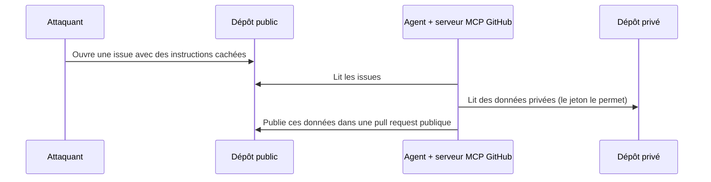
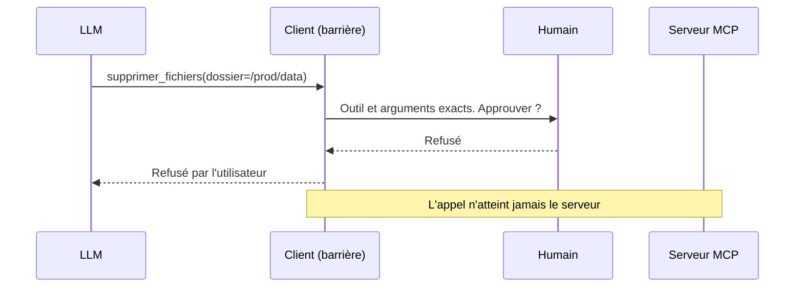

## Portée des outils {#portee}

Chaque outil donne un pouvoir. On ne donne que le pouvoir nécessaire.

Mai 2025. Invariant Labs montre une attaque contre le serveur MCP officiel de GitHub.

:::pourquoi
Le serveur n'avait pas de bug au sens classique.
Le problème : un jeton qui ouvrait tous les dépôts, et un agent qui lisait du contenu public.
Invariant recommande un dépôt par session et des droits fins.
:::

Simon Willison nomme le schéma général le **trio fatal** : données privées, contenu non fiable, communication externe.

:::pourquoi
Le contenu non fiable porte l'ordre. Les données privées sont la cible. La sortie externe sert à les voler.
Retire un seul des trois, et l'attaque échoue.
:::

Règles :

- jeton en lecture seule si l'agent ne fait que lire ;
- limité à un projet, un dossier, un dépôt ;
- des outils précis plutôt qu'un outil qui fait tout.

:::pourquoi
`executer_sql` peut aussi faire `DROP TABLE`.
`lire_commande` ne peut que lire une commande.
Les droits sont appliqués par le service. Le modèle ne peut pas les contourner.
:::

## Sandbox {#sandbox}

Un outil qui exécute du code ou des commandes tourne dans un **bac à sable**.

| Limite | Pourquoi |
|---|---|
| Conteneur ou VM | Pas d'accès à tes fichiers |
| Aucun secret dans l'environnement | Rien à voler |
| Réseau coupé ou liste blanche | Rien à envoyer dehors |
| Temps, mémoire, disque bornés | Une boucle infinie ne bloque rien |
| Dossier de travail seul en écriture | Pas de modification ailleurs |

:::pourquoi
Le code généré peut être faux.
Il peut aussi être dicté par une injection.
L'isolement limite les dégâts dans les deux cas.
:::

Sépare développement et production.

:::pourquoi
Chez Replit, la même base servait au test et à la production.
Une erreur de l'agent en développement a effacé la production.
:::

Un serveur MCP stdio tourne avec **tes** droits.

:::pourquoi
C'est un programme lancé sur ta machine.
MCP ne l'isole pas.
L'installer, c'est exécuter son code.
:::

## Confirmation humaine {#confirmation}

La spécification MCP recommande un humain capable de refuser un appel d'outil.

Quoi confirmer :

- l'irréversible : suppression, envoi, publication ;
- ce qui sort : un mail, un message, une requête vers l'extérieur ;
- l'argent ;
- la production.

:::pourquoi
Trop de confirmations tuent la confirmation.
L'utilisateur clique « oui » par réflexe.
On la garde pour ce qui compte.
:::

Montre l'outil et ses arguments **exacts**.

:::pourquoi
« L'agent veut envoyer un mail » ne dit pas à qui.
Voir le destinataire révèle une fuite.
:::

La barrière est dans le **code**, pas dans le prompt.

:::pourquoi
Le gel de Replit était une consigne. Il a été ignoré.
Un appel bloqué dans le code n'atteint jamais le serveur.
:::

Journalise chaque appel : qui, quel outil, quels arguments, quelle décision.

:::pourquoi
Sans trace, impossible de comprendre un incident.
C'est le sujet de l'étape 6.
:::

## À retenir

- Moindre privilège : lecture seule, portée réduite, outils précis.
- Le trio fatal : données privées, contenu non fiable, sortie externe. Retire-en un.
- Code généré en bac à sable. Développement séparé de la production.
- Confirmation humaine pour l'irréversible, imposée par le code.
