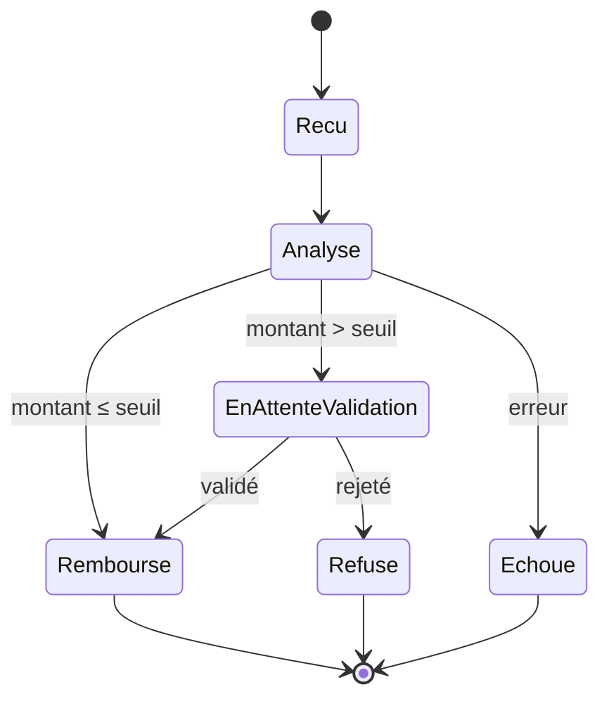
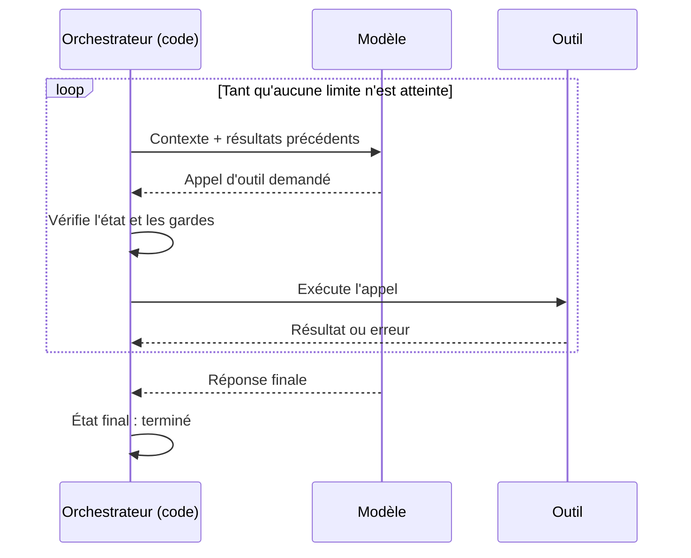

## États et transitions {#etats}

Un agent en production a un **état**. Un nom précis, sauvegardé, lisible.

Chaque état liste ses **transitions** permises. Le reste est refusé.

:::pourquoi
On sait toujours où en est l'agent.
On sait ce qu'il a le droit de faire maintenant.
Une action hors du graphe ne peut pas arriver.
:::

Le **code** fixe le graphe. Le **modèle** choisit parmi les transitions permises.

:::pourquoi
Le modèle propose. La machine dispose.
Le graphe se teste sans modèle.
:::

Anthropic distingue deux formes. Le **workflow** suit des chemins de code prédéfinis. L'**agent** dirige lui-même son processus et ses outils.

:::pourquoi
La machine à états prend le meilleur des deux.
Le modèle garde l'initiative.
Le code garde les limites.
:::

Les règles métier vont dans des **gardes** : des conditions vérifiées avant une transition.

:::pourquoi
Claudius vendait sous le prix d'achat.
Une garde « prix ≥ coût » aurait refusé ce changement.
Une consigne dans le prompt, elle, peut être oubliée.
:::

Prévois toujours des **états finaux** : terminé, échoué, abandonné.

:::pourquoi
Sans état final, impossible de savoir si une tâche est finie.
« Échoué » déclenche une alerte ou une reprise.
:::

## La boucle d'agent {#boucle}

Le cœur d'un agent est une boucle.

Elle s'arrête dans deux cas : le modèle répond sans appeler d'outil, ou une **limite** est atteinte.

:::pourquoi
Le modèle peut tourner en rond.
Anthropic recommande des conditions d'arrêt, comme un nombre maximum d'itérations.
:::

Trois limites :

| Limite | Évite |
|---|---|
| Nombre de tours | La boucle sans fin |
| Budget de tokens ou de coût | La facture surprise |
| Durée maximale | La tâche bloquée pendant des heures |

:::pourquoi
Chaque limite couvre un risque différent.
La première atteinte arrête la boucle, avec l'état « échoué ».
:::

Détecte les répétitions : même outil, mêmes arguments, plusieurs fois.

:::pourquoi
Le même appel donne le même résultat.
L'agent est coincé. Mieux vaut le dire que payer dix tours de plus.
:::

Quand un outil échoue, **dis-le** au modèle. Clairement.

:::pourquoi
Anthropic l'a observé : l'agent qui sait qu'un outil échoue change de stratégie.
Celui à qui on cache l'erreur construit sur du vide.
:::

## À retenir

- Un état explicite, des transitions listées, des états finaux.
- Le code fixe le graphe et les gardes. Le modèle choisit dans ce cadre.
- La boucle s'arrête sur une réponse finale ou sur une limite : tours, coût, temps.
- Les échecs d'outil sont dits au modèle, pas cachés.
