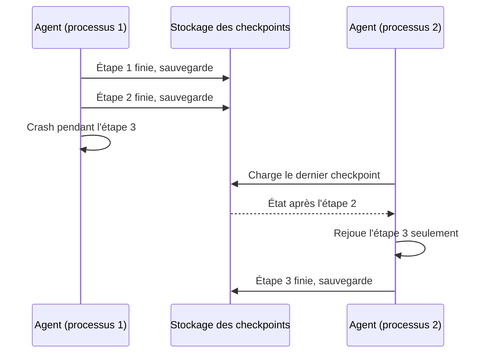
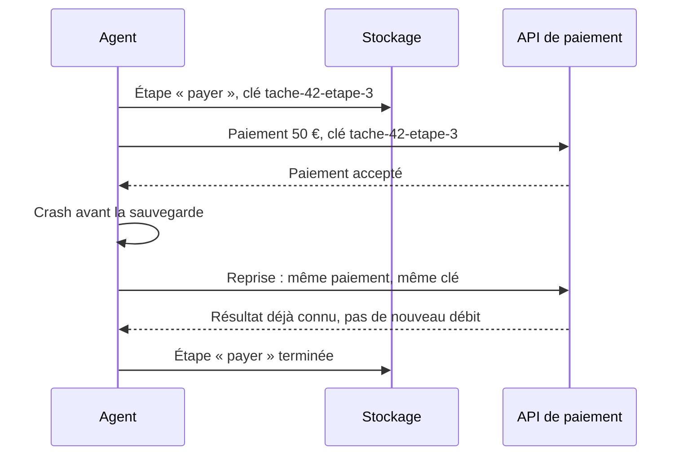

## Checkpoint {#checkpoint}

Un agent peut tourner des heures. Le processus peut mourir à tout moment.

Un **checkpoint** sauvegarde l'état après chaque étape. Dans un stockage durable.

:::pourquoi
Ce qui n'est qu'en mémoire meurt avec le processus.
Une base de données survit au crash.
:::

Ce qu'il contient :

| Élément | Sert à |
|---|---|
| État courant | Savoir où on en est |
| Résultats d'outils | Ne pas refaire le travail |
| Contexte utile | Laisser le modèle continuer |
| Version du format | Relire après une mise à jour |

:::pourquoi
Chaque élément manquant oblige à refaire ou à deviner.
:::

Un checkpoint rend aussi l'**attente** gratuite. L'agent attend un humain ? On sauvegarde, on libère le processus.

:::pourquoi
Un processus qui attend une journée occupe des ressources.
Et il peut redémarrer entre-temps.
:::

## Reprise après crash {#reprise}

Reprendre, c'est recharger le dernier checkpoint et continuer.

:::pourquoi
Anthropic l'écrit pour son système de recherche.
Redémarrer un agent long depuis zéro coûte cher et frustre.
Ils reprennent là où l'erreur est arrivée.
:::

Les déploiements aussi interrompent. Anthropic fait tourner l'ancienne et la nouvelle version côte à côte, et bascule le trafic peu à peu.

:::pourquoi
Un agent en cours suit le code avec lequel il a commencé.
Changer ce code en route peut casser son état.
:::

Mets un **numéro de version** dans chaque checkpoint.

:::pourquoi
Le code change. Les sauvegardes restent.
La version dit comment relire, et quelle migration appliquer.
:::

## Idempotence {#idempotence}

À la reprise, l'étape interrompue est **rejouée**. Elle a peut-être déjà agi.

Une opération **idempotente** a le même effet faite une ou deux fois.

:::pourquoi
« Mettre le statut à payé » : deux fois, même résultat.
« Ajouter 10 € » : deux fois, 20 €.
Seule une étape idempotente se rejoue sans risque.
:::

Pour les API qui le permettent, envoie une **clé d'idempotence**. Stripe, par exemple, la reçoit dans un en-tête et renvoie le même résultat pour la même clé.

:::pourquoi
Le serveur reconnaît la requête déjà traitée.
Il ne la refait pas.
:::

La clé reste la **même** d'une tentative à l'autre : id de la tâche plus numéro d'étape, ou générée une fois et sauvegardée avant l'appel.

:::pourquoi
Une clé neuve à chaque essai ne protège de rien.
Le serveur verrait deux requêtes différentes.
:::

Sans clé côté API, construis l'idempotence toi-même : note l'intention, vérifie avant d'agir, marque comme fait.

:::pourquoi
Le registre dit si l'action a déjà eu lieu.
Une petite fenêtre de doute reste. On la journalise.
:::

## À retenir

- Checkpoint après chaque étape, en stockage durable, avec une version.
- Reprise : recharger, puis rejouer seulement l'étape interrompue.
- Toute étape rejouable doit être idempotente.
- Clé d'idempotence stable : même clé pour chaque tentative.
