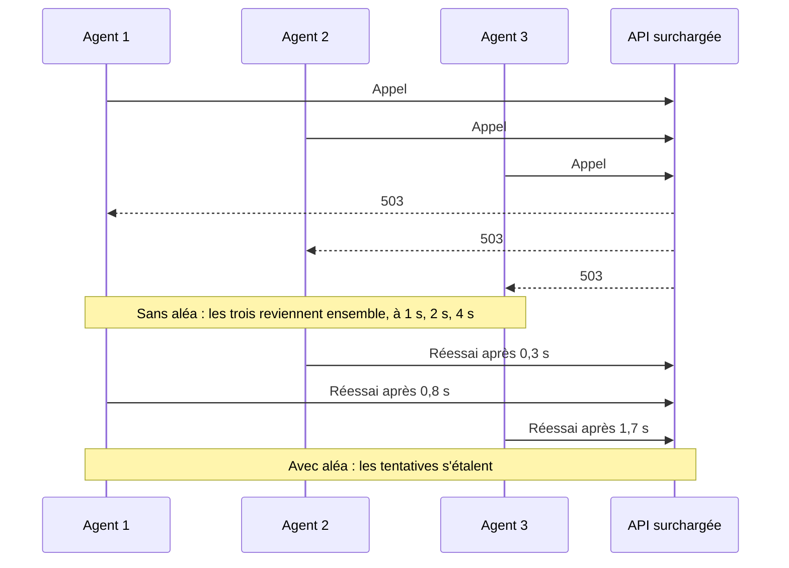
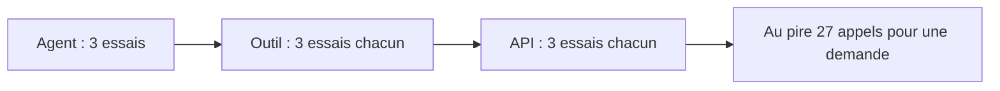

## Timeouts {#timeouts}

Tout appel peut rester sans réponse. Chaque appel a un **timeout**.

:::pourquoi
Sans limite, l'agent attend pour toujours.
Le timeout transforme le silence en erreur gérable.
:::

Choisis la valeur à partir de la **latence mesurée**. Un percentile élevé, avec une marge.

:::pourquoi
Trop court, on coupe des appels qui allaient réussir.
Trop long, on attend pour rien.
:::

Ajoute un **délai global** pour toute la tâche.

:::pourquoi
Cent appels de 30 secondes respectent chacun leur timeout.
Ensemble, ils font 50 minutes.
:::

Un timeout ne dit pas que l'opération a échoué.

:::pourquoi
Le serveur a pu la traiter, puis répondre trop tard.
Avant de réessayer une action, il faut l'idempotence.
:::

## Backoff exponentiel et aléa {#backoff}

On ne réessaie pas tout de suite. On attend, de plus en plus : c'est le **backoff exponentiel**.

On ajoute de l'**aléa** : chaque client tire son attente au hasard.



:::pourquoi
Mille clients qui réessaient au même instant recréent la surcharge.
Marc Brooker (AWS, 2015) l'a simulé : sans aléa, c'est clairement la pire option.
:::

La formule « full jitter » :

```text
attente = aleatoire(0, min(plafond, base × 2^tentative))
```

:::pourquoi
L'exponentielle laisse de plus en plus d'air au service.
Le plafond évite d'attendre des heures.
Le hasard étale les clients.
:::

Le serveur dit quand revenir ? Écoute-le. Un `429` avec `Retry-After: 20` veut dire : pas avant 20 secondes.

:::pourquoi
Le serveur connaît sa charge mieux que toi.
:::

## Limiter les tentatives {#limites}

Toutes les erreurs ne se réessaient pas.

| Erreur | Réessayer ? | Pourquoi |
|---|---|---|
| Timeout, 503, 429 | Oui, avec backoff | Souvent passagère |
| 400, argument invalide | Non, renvoyer au modèle | Elle se reproduira |
| 401, 403 | Non, escalader | Un droit manque |

:::pourquoi
Le backoff ne corrige pas une date mal écrite.
Le modèle, lui, peut la corriger si on lui dit pourquoi.
:::

Fixe un **nombre maximum** de tentatives. Ensuite : état « échoué », alerte, humain.

:::pourquoi
Après quelques essais, la panne n'est plus passagère.
Insister charge le service et retarde la réaction.
:::

Réessaie à **une seule couche**.



:::pourquoi
Les tentatives se multiplient d'une couche à l'autre.
En pleine panne, ce sont elles qui achèvent le service.
:::

## À retenir

- Un timeout par appel, plus un délai global. Un timeout n'est pas un échec certain.
- Backoff exponentiel, plafonné, avec aléa. Respecter `Retry-After`.
- Réessayer seulement les erreurs passagères. Les erreurs de contenu vont au modèle.
- Peu de tentatives, à une seule couche. Puis échec explicite.
