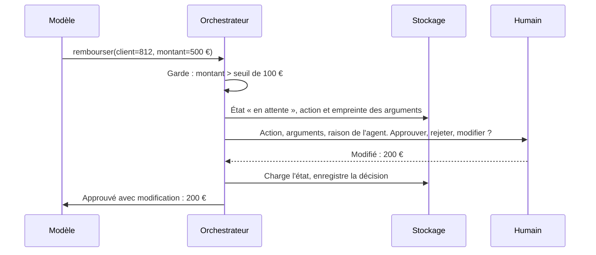

## Étapes à valider {#a-valider}

Certaines étapes passent par un **humain** avant d'agir.

Lesquelles :

- l'irréversible : supprimer, envoyer, publier ;
- l'argent : payer, rembourser, accorder une remise ;
- ce qui sort : un mail, un message, une requête vers l'extérieur ;
- la production.

:::pourquoi
Une erreur réversible se corrige.
Un virement parti, non.
L'humain se place là où l'erreur coûte cher.
:::

Le seuil dépend du **risque** : montant, réversibilité, destinataire.

:::pourquoi
Claudius cédait aux demandes de remise sur Slack.
Un seuil dans le code ne se laisse pas convaincre.
Au-delà, l'humain décide.
:::

Pas de validation partout.

:::pourquoi
Trop de demandes, et l'humain clique « oui » par réflexe.
La validation perd toute valeur.
:::

Dans la machine à états, la validation est un **état** : « en attente ». La tâche est sauvegardée et le processus libéré.

:::pourquoi
Un humain peut répondre dans trois heures.
Un checkpoint rend cette attente gratuite.
:::

## Approuver ou rejeter {#decision}

Montre l'action **exacte** : outil, arguments, raison donnée par l'agent, effet attendu.

:::pourquoi
« Rembourser » ne dit ni combien, ni à qui.
On ne juge que ce qu'on voit.
:::

Trois réponses : **approuver**, **rejeter** avec une raison, **modifier**.

:::pourquoi
La raison d'un rejet guide l'agent.
La modification évite de tout recommencer.
:::

Un rejet est renvoyé au modèle. Il propose autre chose, ou s'arrête.

:::pourquoi
Réessayer la même action ignore l'humain.
:::

L'approbation vaut pour **ces** arguments. S'ils changent, on redemande.

:::pourquoi
Sinon on approuve 50 € et on exécute 500 €.
Une empreinte des arguments lie la décision à l'action.
:::

Pas de réponse ? L'action **n'a pas lieu**.

:::pourquoi
Le silence n'est pas un accord.
La demande expire, on prévient, on trace.
:::

Journalise chaque décision : qui, quand, quoi, quelle réponse.

:::pourquoi
En cas d'incident, on sait qui a validé quoi.
Et les statistiques montrent où ajuster le seuil.
:::

## À retenir

- Valider l'irréversible, l'argent, la sortie externe, la production. Pas le reste.
- La validation est un état sauvegardé, pas un processus qui attend.
- Montrer l'action exacte. Approuver, rejeter, modifier.
- Approbation liée aux arguments. Sans réponse, rien ne part. Tout est journalisé.
