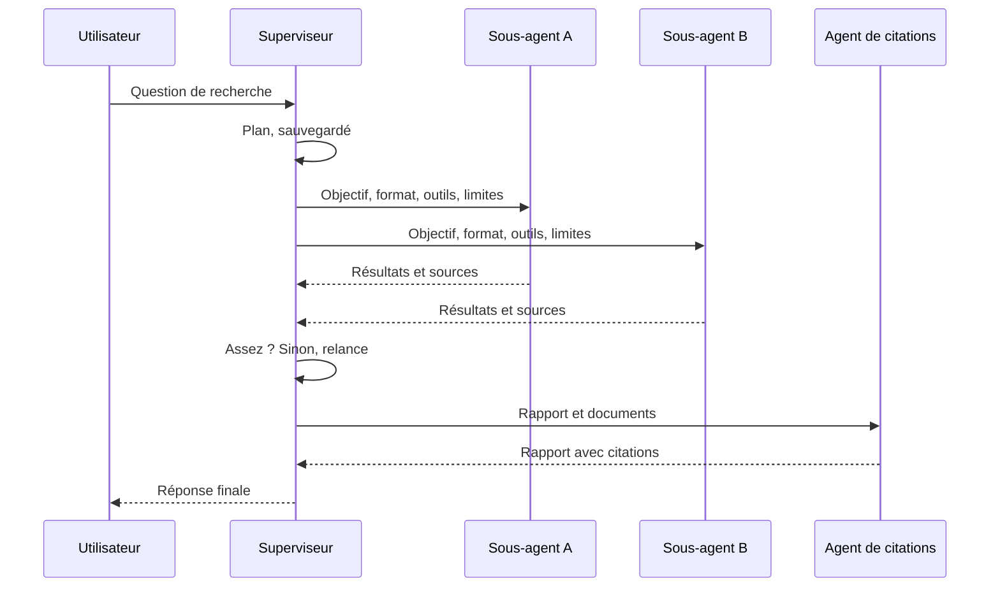
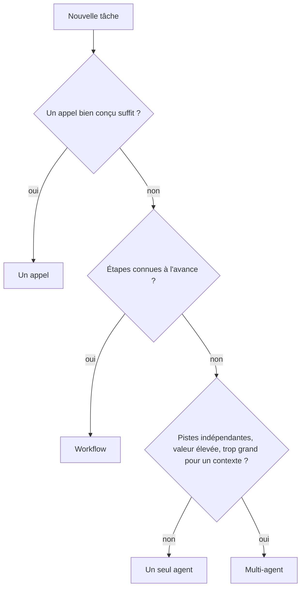

## Topologies {#topologies}

Plusieurs agents peuvent travailler ensemble. Trois formes reviennent souvent.

| Topologie | Principe | Quand |
|---|---|---|
| Orchestrateur et travailleurs | Un agent découpe, délègue, assemble | Découpage inconnu à l'avance |
| Parallélisation par découpage | Chaque agent traite une partie | Parties indépendantes |
| Parallélisation par vote | Plusieurs agents, même tâche | Besoin de confiance |

:::pourquoi
Anthropic décrit ces motifs dans « Building effective agents ».
Chacun répond à un besoin différent : vitesse, couverture, fiabilité.
:::

Anthropic a construit un système de recherche en orchestrateur et travailleurs. Un Opus 4 dirige des sous-agents Sonnet 4. Résultat : +90,2 % par rapport à un Opus 4 seul, sur leur évaluation interne.

:::pourquoi
Les questions de recherche larges s'explorent en parallèle.
Chaque sous-agent fouille une piste avec son propre contexte.
:::

Le prix : environ **15 fois** les tokens d'un chat. Un agent seul : environ 4 fois.

:::pourquoi
Chaque sous-agent a son contexte, ses appels, ses résultats.
La tâche doit valoir ce coût.
:::

## Superviseur {#superviseur}



Le superviseur **découpe**, **délègue**, **rassemble**, **décide** de la fin.

:::pourquoi
Chaque sous-agent ne voit qu'un morceau.
Seul le superviseur voit l'ensemble.
:::

Chaque délégation précise : l'objectif, le format de sortie, les outils, les limites.

:::pourquoi
Une consigne vague donne du travail en double, ou à côté.
Les limites disent aussi ce que font les autres.
:::

Une tâche précise peut avoir son agent précis. Chez Anthropic, un agent dédié ajoute les citations à la fin.

:::pourquoi
Relier chaque affirmation à sa source est un travail à part.
Un agent spécialisé le fait mieux qu'en passant.
:::

## État typé {#etat-type}

Les agents partagent un **état typé** : des champs nommés, avec un type et un propriétaire.

```json
{
  "question": "string",
  "pistes": [{ "id": "string", "agent": "string", "statut": "a_faire | en_cours | fini" }],
  "sources": [{ "url": "string", "extrait": "string", "piste": "string" }],
  "rapport": "string | null"
}
```

:::pourquoi
Un résumé en texte libre se lit de dix façons.
Un champ typé se valide.
:::

Chaque champ a une règle d'écriture : un seul propriétaire, ou une fusion définie.

:::pourquoi
« Le dernier qui écrit gagne » efface un travail sans bruit.
Une liste de sources se concatène. Un statut a un seul maître.
:::

La sortie d'un sous-agent est validée **avant** d'entrer dans l'état.

:::pourquoi
À la frontière, on sait quel agent a produit l'erreur.
Après la fusion, elle contamine tout.
:::

## Conflits {#conflits}

Cognition raconte un exemple. Tâche : un clone de Flappy Bird. Un sous-agent fait un décor façon Mario. L'autre, un oiseau qui ne va pas avec.

:::pourquoi
Chaque action porte des décisions implicites : un style, une hypothèse.
Un agent qui ne voit pas les choix de l'autre décide autrement.
Cognition en tire un principe : partager tout le contexte.
:::

Deux résultats se contredisent ? Le superviseur compare les sources. Il tranche, ou il signale le désaccord.

:::pourquoi
Une moyenne de deux chiffres faux reste fausse.
Un désaccord visible vaut mieux qu'une certitude inventée.
:::

Pour une réponse courte et comparable, le **vote** marche bien : plusieurs agents, la majorité gagne.

:::pourquoi
« 42 », « 42 », « 41 » se comptent.
Trois rapports rédigés, non.
:::

L'étude MAST (2025) classe 14 modes d'échec en 3 catégories : conception du système, désalignement entre agents, vérification de la tâche.

:::pourquoi
La plupart des échecs ne viennent pas du modèle seul.
Ils viennent de l'organisation entre agents.
:::

## Quand un seul agent suffit {#un-seul}

Souvent.

Anthropic le dit : le multi-agent convient mal aux tâches où tous doivent partager le même contexte, et à la plupart du code.

:::pourquoi
Dans le code, une décision en contraint dix autres.
Des sous-agents isolés ne voient pas ces liens.
:::

Cognition recommande un seul agent, linéaire. Quand le contexte devient long, on le compresse.

:::pourquoi
Un seul fil voit toutes ses décisions.
Rien ne se perd entre deux agents.
:::

Sur BrowseComp, l'usage de tokens explique à lui seul 80 % des écarts de performance mesurés par Anthropic.

:::pourquoi
Une bonne part du gain vient de la dépense.
La vraie question : la tâche vaut-elle ce coût ?
:::



:::pourquoi
Anthropic conseille de commencer par la solution la plus simple.
On n'ajoute de la complexité que si elle améliore mesurablement le résultat.
:::

## À retenir

- Orchestrateur et travailleurs, découpage, vote : chaque topologie a son usage.
- Le superviseur délègue avec objectif, format, outils, limites. Il décide de la fin.
- État typé, propriétaire par champ, validation à la frontière.
- Les conflits viennent du contexte non partagé. Comparer les sources, voter sur du comparable.
- Un seul agent suffit souvent. Le multi-agent coûte environ 15 fois un chat.
