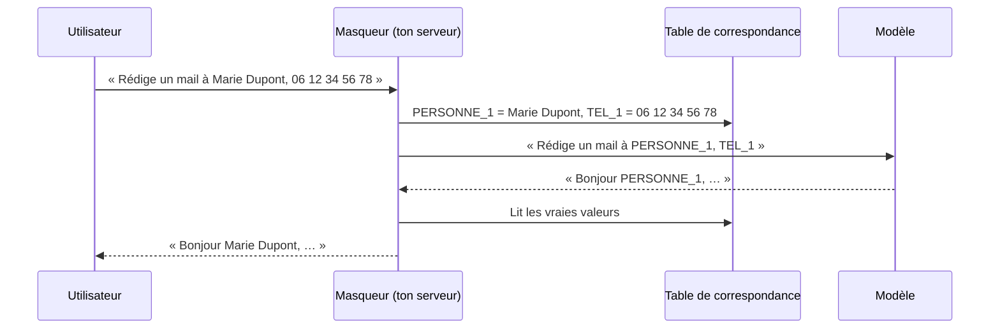
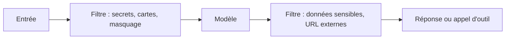

## Masquage réversible {#masquage}

Avant d'envoyer un texte au modèle, on **remplace** les données personnelles par des jetons.

:::pourquoi
Le modèle n'a pas besoin du vrai nom pour rédiger.
Ce qu'il ne reçoit pas, il ne peut ni le garder ni le fuiter.
:::

La **table** reste chez toi. Ni dans le prompt, ni dans les logs.

:::pourquoi
La table est la clé.
L'envoyer ou la journaliser annule le masquage.
:::

Un même nom garde le **même jeton** dans toute la conversation.

:::pourquoi
Sinon le modèle croit voir plusieurs personnes.
Le masquage ne doit pas casser la tâche.
:::

Combine les détecteurs : règles exactes pour les formats connus (e-mail, téléphone, IBAN), modèle de détection pour les noms.

:::pourquoi
Un détecteur statistique rate des cas.
5 % de ratés sur un million de messages, c'est 50 000 fuites.
:::

La restauration suit les **droits** de la source.

:::pourquoi
L'agent ne doit pas montrer à quelqu'un ce qu'il n'aurait pas pu voir lui-même.
:::

Pseudonymiser n'est pas anonymiser. Pour le RGPD, ce sont encore des données personnelles.

:::pourquoi
Avec la table, on retrouve la personne.
Le risque baisse. Les obligations restent.
:::

## Ce qui ne sort jamais {#jamais}

Avril 2023. Des ingénieurs de Samsung collent du code source interne dans ChatGPT pour le corriger. Début mai, Samsung restreint ces outils sur ses appareils et réseaux.

:::pourquoi
La fuite ne venait pas d'une attaque.
Elle venait d'un usage normal, sans garde-fou.
OWASP classe ce risque en deuxième position en 2025.
:::

Trois catégories :

| Catégorie | Exemples | Règle |
|---|---|---|
| Secrets | Mots de passe, clés d'API, jetons | Jamais dans le contexte |
| Données très sensibles | Carte bancaire, santé, pièces d'identité | Bloquées ou masquées avant l'appel |
| Le reste | Tout ce que la tâche n'exige pas | Pas envoyé : minimisation |

:::pourquoi
Ce qui n'entre pas dans le contexte ne peut pas en sortir.
:::

Les clés d'API vivent dans le **code de l'outil**. Le modèle ne les voit jamais.

:::pourquoi
Le modèle choisit l'outil. Le code ajoute l'authentification.
Même sous injection, il ne peut pas révéler une clé qu'il n'a pas.
:::

Le prompt système n'est pas un coffre-fort.

:::pourquoi
C'est du texte dans le contexte.
Des utilisateurs réussissent régulièrement à le faire réciter.
:::

Filtre **à l'entrée** et **à la sortie** : réponse, URL, arguments d'outils.

:::pourquoi
L'entrée filtrée peut laisser passer un cas.
Un outil peut ramener une donnée sensible en cours de route.
La sortie est le dernier point de contrôle.
:::

## À retenir

- Masquer avant l'appel, restaurer après. La table reste chez toi.
- Jetons stables, détecteurs combinés, restauration selon les droits.
- Pseudonymisé reste personnel au sens du RGPD.
- Jamais de secret dans le contexte. Le prompt système n'est pas secret.
- Filtrer à l'entrée et à la sortie.
