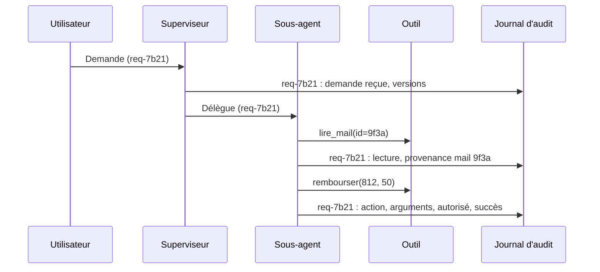
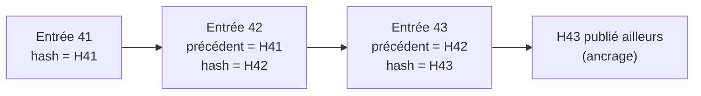

## Quoi tracer {#quoi-tracer}

Un incident se découvre **après**. Le journal d'audit permet de le reconstituer.

Pour chaque action :

| Champ | Exemple | Sert à |
|---|---|---|
| Qui | utilisateur 812, agent « support-v3 » | Responsabilité |
| Quoi | `rembourser`, `{client: 812, montant: 50}` | Comprendre l'action |
| Provenance | e-mail 9f3a, page doc.interne/x | Retrouver une injection |
| Décision | autorisé par la politique, validé par Alice | Contrôle |
| Résultat | succès, refus, erreur | Conséquence |
| Versions | modèle, prompt, code | Reproduire |
| Quand | horodatage | Chronologie |
| Corrélation | `req-7b21` | Relier les agents |

:::pourquoi
Sans provenance, on voit l'action mais pas sa cause.
Sans version, on ne peut pas reproduire.
Sans corrélation, une demande éclatée sur cinq agents est illisible.
:::

Pas de secret dans le journal. Les données personnelles masquées ou réduites.

:::pourquoi
Le journal est lu par plus de monde, et gardé plus longtemps, que la base d'origine.
Un secret dans un log est une fuite qui dure.
:::

L'AI Act européen exige pour les systèmes à haut risque un enregistrement automatique des événements (article 12). Les journaux sont conservés au moins six mois, sauf autre règle (article 19).

:::pourquoi
Le législateur veut la traçabilité de ces systèmes.
Même hors haut risque, c'est la base pour enquêter.
:::

## Rendre inaltérable {#inalterable}

Un journal qu'on peut modifier ne prouve rien.

**Ajout seul** : l'agent écrit de nouvelles entrées. Il ne modifie ni ne supprime.

:::pourquoi
Un agent piégé pourrait effacer la trace de l'attaque.
:::

**Chaîne de hachage** : chaque entrée contient l'empreinte de la précédente.

:::pourquoi
Modifier l'entrée 41 change son hash.
L'entrée 42 ne correspond plus. La modification se voit.
:::

**Ancrage** : publie régulièrement le dernier hash ailleurs. Ou stocke en **écriture unique**.

:::pourquoi
Qui contrôle tout peut recalculer toute la chaîne.
Un hash publié ailleurs l'en empêche.
:::

**Vérifie** la chaîne automatiquement, et alerte si elle casse.

:::pourquoi
Une protection jamais vérifiée ne protège rien.
:::

**Sépare** les rôles : l'agent ajoute, les auditeurs lisent, personne ne réécrit.

## À retenir

- Tracer : qui, quoi, provenance, décision, résultat, versions, heure, corrélation.
- Pas de secret. Données personnelles masquées.
- AI Act, haut risque : journaux automatiques, au moins six mois.
- Ajout seul, chaîne de hachage, ancrage externe, vérification régulière.
