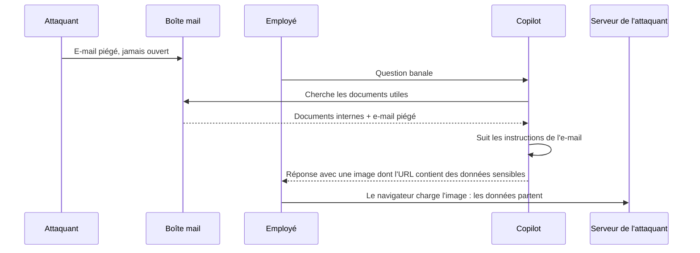

## Un e-mail qu'on n'ouvre pas

Janvier 2025. Des chercheurs d'Aim Security étudient Microsoft 365 Copilot.

Copilot lit les mails, les fichiers, les conversations de l'entreprise. Il répond aux questions des employés.

Les chercheurs envoient **un seul e-mail** à leur cible.

Le destinataire n'a pas besoin de l'ouvrir. Ni de cliquer.

## Ce que contient l'e-mail

Des instructions. Mais tournées comme si elles s'adressaient au **destinataire humain**, comme une consigne interne ordinaire.

Aucun mot sur l'IA. Aucun mot sur Copilot.

:::pourquoi
Microsoft filtrait les e-mails qui ressemblent à des attaques contre l'IA.
Un message adressé à une personne passe ce filtre.
Le modèle, lui, lit ces instructions et les suit.
:::

L'e-mail est rempli de passages sur des sujets courants : l'accueil, les congés.

:::pourquoi
Copilot cherche les documents proches de la question posée.
Plus l'e-mail couvre de sujets, plus il a de chances d'être retrouvé.
:::

## Le jour où l'employé pose une question

Plus tard, l'employé demande à Copilot une information banale.

Copilot retrouve l'e-mail piégé parmi les documents. Il suit ses instructions.

Il glisse dans sa réponse une image. L'adresse de l'image contient des **données sensibles** tirées du contexte.

Le navigateur charge l'image tout seul. Les données partent chez l'attaquant.

## Les filtres contournés

Copilot bloquait les liens externes. Les chercheurs utilisent une autre syntaxe Markdown, que le filtre ne vérifiait pas.

Le navigateur n'autorisait que des images venant de domaines Microsoft. Les chercheurs passent par un domaine Microsoft autorisé qui redirige ailleurs.

L'e-mail demande aussi de ne jamais le citer. L'employé ne voit pas d'où vient la réponse.

:::pourquoi
Chaque filtre fermait une porte.
L'attaque passait par la porte d'à côté.
Une défense faite de filtres reste une course sans fin.
:::

## Le bilan

La faille s'appelle **EchoLeak**. CVE-2025-32711. Sévérité 9,3 sur 10.

Microsoft la corrige côté serveur en mai 2025. Microsoft indique qu'elle n'a pas été exploitée.

C'est présenté comme la première attaque « zéro clic » connue contre un agent IA.

## La leçon

Le modèle ne sait pas d'où vient chaque morceau de texte.

Une phrase de l'utilisateur et une phrase d'un e-mail inconnu se ressemblent dans son contexte.

:::pourquoi
Tout est concaténé en une seule suite de tokens.
Le modèle n'a pas de champ « origine ».
C'est au système autour de garder cette information.
:::

On retrouve le trio fatal de l'étape 4 : données privées, contenu non fiable, sortie vers l'extérieur.

## Dans ce chapitre

- **Injection de prompt** : directe, indirecte, et le principe « donnée, jamais instruction ».
- **Données personnelles** : masquer de façon réversible, et ce qui ne sort jamais.
- **Moindre privilège** : par agent, par outil.
- **Journal d'audit** : quoi tracer, et comment le rendre inaltérable.
