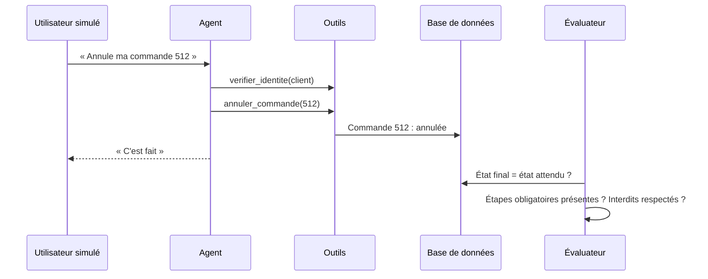

## La réponse {#reponse}

On évalue d'abord ce que l'utilisateur reçoit.

| Aspect | Question | Comment |
|---|---|---|
| Exactitude | Est-ce juste ? | Code si possible, sinon juge |
| Ancrage | Les sources le disent-elles ? | Juge, vérification des citations |
| Complétude | Tout est-il couvert ? | Liste de points attendus |
| Format | JSON valide, champs présents ? | Code |
| Abstention | Refuse-t-il quand il le faut ? | Cas sans réponse dans le jeu de test |
| Comportement | Ton, complaisance, sécurité | Juge, tests dédiés |

:::pourquoi
Une réponse peut réussir un aspect et rater les autres.
Une note globale cache ce qui casse.
:::

Ce qui se vérifie par **code** se vérifie par code.

:::pourquoi
Un montant, un format, un champ : comparaison exacte.
Rapide, gratuit, déterministe.
Le juge LLM est pour le reste.
:::

Chaque risque connu a **son** test.

:::pourquoi
Les tests de GPT-4o étaient bons.
Aucun ne mesurait la complaisance.
Une évaluation ne voit que ce qu'elle mesure.
:::

## La trajectoire {#trajectoire}

La **trajectoire**, c'est le chemin : outils appelés, arguments, résultats, décisions.

Un bon résultat ne suffit pas.

:::pourquoi
Un remboursement juste sans vérification d'identité passe aujourd'hui.
Demain, c'est un fraudeur qui en profite.
:::

τ-bench (2024) simule un client avec un modèle. Il juge l'agent sur l'**état final** de la base, comparé à l'état attendu.

:::pourquoi
Ce qui compte est ce qui a changé dans le système.
L'agent peut dire « c'est fait » sans l'avoir fait.
:::

Mesure la **régularité** : pass^k, réussir la même tâche k fois sur k.

:::pourquoi
Dans τ-bench, les meilleurs agents réussissaient moins de la moitié des tâches.
Dans le domaine retail, pass^8 tombait sous 25 %.
En production, la même tâche revient des milliers de fois.
:::

Suis aussi : nombre d'étapes, appels répétés, erreurs d'outil, coût, durée.

:::pourquoi
Ils expliquent pourquoi un agent échoue, ou réussit trop cher.
:::

Ne fige pas un chemin unique quand plusieurs sont valides.

:::pourquoi
Anthropic le note pour ses agents de recherche.
Juger le résultat et les règles du processus évite de punir une bonne solution différente.
:::

## À retenir

- Évaluer la réponse par aspects : exactitude, ancrage, complétude, format, abstention, comportement.
- Le code quand c'est possible. Un test par risque connu.
- Évaluer la trajectoire : état final, étapes obligatoires, interdits.
- Mesurer la régularité (pass^k), pas seulement le meilleur essai.
