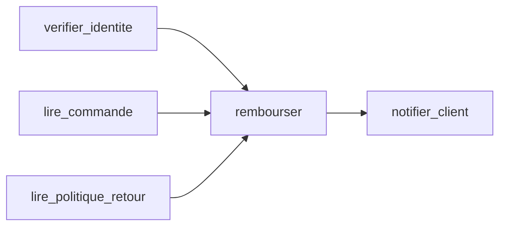

## Golden set {#golden-set}

Un **golden set** : des cas de test fixes, chacun avec son résultat attendu, vérifié par un humain.

```yaml
- id: remb-017
  entree: "Je veux être remboursé de la commande 512, l'article est arrivé cassé."
  attendu:
    etat_final: { commande_512: rembourse, montant: 49.90 }
    etapes_obligatoires: [verifier_identite, lire_commande, rembourser]
    interdits: [envoyer_mail_externe]
  origine: "ticket réel #8812, anonymisé"
```

:::pourquoi
Sans référence fixe, on ne peut pas comparer deux versions.
On compare des impressions.
:::

D'où viennent les cas :

- de **vraies demandes**, anonymisées ;
- de chaque **bug** corrigé ;
- de **cas limites** écrits exprès : sans réponse, ambigus, malveillants.

:::pourquoi
Un bug devenu test ne revient pas sans qu'on le voie.
Les cas limites coûtent cher quand ils ratent.
:::

Affiche une **marge d'erreur**. Compare les versions **cas par cas**.

:::pourquoi
Avec 20 cas, un cas qui bascule fait 5 points.
Anthropic recommande de donner l'erreur standard avec chaque score.
Et d'analyser les différences appariées : même cas, deux versions.
:::

Garde un jeu **mis de côté**, jamais utilisé pour régler le prompt.

:::pourquoi
À force d'ajuster sur les mêmes cas, le prompt les apprend.
Le score monte. Le comportement réel, non.
:::

## DAG attendu {#dag}

Pour un agent, l'attendu est souvent un **chemin**. Mais pas un chemin unique.

Un **DAG** (graphe orienté sans cycle) décrit les étapes requises et leurs dépendances.



`lire_commande` et `lire_politique_retour` peuvent venir dans n'importe quel ordre. `rembourser` vient après les trois.

:::pourquoi
Une liste ordonnée rejette des trajectoires correctes.
Le DAG n'impose que les vraies dépendances.
:::

On vérifie :

| Contrôle | Échoue si |
|---|---|
| Présence | Une étape obligatoire manque |
| Dépendances | Une étape arrive avant ce dont elle dépend |
| Interdits | Une action interdite apparaît |
| Arguments | Un champ clé diffère : id, montant |
| Extras | Permises, mais comptées dans le coût |

:::pourquoi
Chaque contrôle attrape une famille d'erreurs.
Ensemble, ils jugent le chemin sans le figer.
:::

Compare les arguments **champ par champ**, avec une règle par champ.

:::pourquoi
L'id doit être exact.
Une requête de recherche peut se formuler de dix façons.
:::

## Note par étape {#note-etape}

On note **chaque étape**, pas seulement la fin.

| Étape | Critère | Note |
|---|---|---|
| 1. verifier_identite | Bon outil, bons arguments | réussi |
| 2. lire_commande | Bon id | raté (id 215 au lieu de 512) |
| 3. lire_commande | Correction après erreur | réussi |
| 4. rembourser | Bon montant, après vérification | réussi |

:::pourquoi
« Échec » ne dit pas quoi corriger.
« Mauvais argument à l'étape 2 » le dit.
:::

Une échelle **simple et définie** : réussi ou raté, ou quelques niveaux décrits.

:::pourquoi
Une note de 0 à 100 sans définition ne se reproduit pas.
Deux correcteurs donneront deux chiffres.
:::

Les critères **évoluent**. Shankar et ses coauteurs (2024) appellent ça la dérive des critères.

:::pourquoi
Noter de vraies sorties fait découvrir de nouveaux critères.
On révise la grille après avoir lu des résultats, pas seulement avant.
:::

## À retenir

- Golden set : cas fixes, attendu vérifié, issus du réel, des bugs et des cas limites.
- Marge d'erreur, comparaison cas par cas, jeu mis de côté.
- DAG attendu : étapes obligatoires, dépendances, interdits. Pas d'ordre imposé inutilement.
- Note par étape, échelle simple, grille révisée en lisant les résultats.
