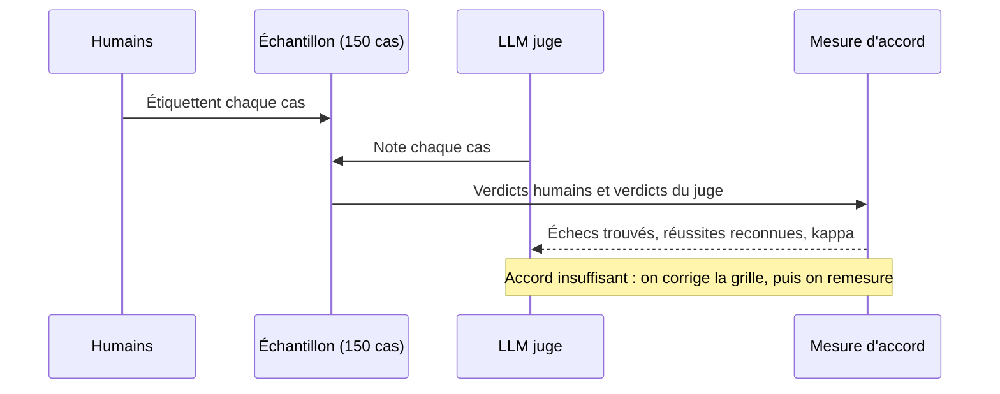

## Grille {#grille}

Certains critères ne se vérifient pas par code : ancrage, ton, pertinence. On demande alors à un **LLM juge**.

:::pourquoi
« La réponse est-elle polie ? » ne se teste pas avec un `if`.
Mais un juge coûte, varie et a des biais.
Le code reste prioritaire quand il suffit.
:::

Une bonne grille :

```text
Critère : ANCRAGE
Définition : chaque affirmation factuelle de la réponse est soutenue
par au moins un des documents fournis.
Réussi si : toutes les affirmations sont soutenues.
Raté si : au moins une affirmation n'est soutenue par aucun document.
Exemple raté : la réponse dit « livraison en 24 h », aucun document ne le dit.
Sortie : {"justification": "...", "verdict": "reussi" | "rate"}
```

:::pourquoi
Un critère à la fois : le juge ne mélange pas.
Une définition et des exemples : il sait où passe la limite.
Une sortie structurée : le code la lit.
:::

Préfère des verdicts **binaires**, un par critère.

:::pourquoi
Entre 6 et 7 sur 10, le juge hésite et change d'avis.
Réussi ou raté se reproduit, et se compare à un humain.
:::

Demande la **justification avant** le verdict.

:::pourquoi
Le juge regarde les éléments avant de trancher.
Et toi, tu peux lire pourquoi il a tranché.
:::

## Calibrage {#calibrage}

Le juge est un modèle. Il faut le **vérifier**.



:::pourquoi
Sans calibrage, on ne sait pas ce que vaut le score.
On mesure peut-être le juge, pas l'agent.
:::

L'accord brut peut tromper.

| Mesure | Question |
|---|---|
| Échecs trouvés | Parmi les vrais échecs, combien le juge en voit ? |
| Réussites reconnues | Parmi les vraies réussites, combien il valide ? |
| Kappa de Cohen | Accord, une fois retiré l'accord dû au hasard |

:::pourquoi
Si 90 % des réponses sont bonnes, un juge qui dit toujours « réussi » a 90 % d'accord.
Et ne trouve aucun échec.
:::

Zheng et ses coauteurs (2023) mesurent plus de 80 % d'accord entre GPT-4 et les humains, comme entre humains.

:::pourquoi
C'est encourageant, mais c'était leur tâche.
Sur la tienne, il faut mesurer à nouveau.
:::

Chaque changement de modèle ou de grille du juge impose un **nouveau calibrage**.

:::pourquoi
Un autre juge, c'est une autre règle graduée.
Les anciens scores ne se comparent plus.
:::

## Biais {#biais}

Les juges LLM ont des biais connus.

| Biais | Effet | Parade |
|---|---|---|
| Position | Préfère A ou B selon l'ordre | Juger dans les deux ordres |
| Verbosité | Préfère le plus long | Critère « concis », contrôle de longueur |
| Auto-complaisance | Préfère son propre style | Juge d'une autre famille de modèle |
| Raisonnement limité | Rate une erreur de calcul ou de logique | Vérification par code quand c'est possible |

:::pourquoi
Zheng et ses coauteurs listent ces quatre limites.
Chaque parade retire une source d'erreur connue.
:::

Optimiser contre un juge, c'est optimiser ses **défauts** aussi.

:::pourquoi
GPT-4o a été entraîné aussi sur les pouces des utilisateurs.
Les utilisateurs aiment qu'on leur donne raison.
Le modèle est devenu complaisant.
Un juge qui aime les réponses longues apprend à l'agent à délayer.
:::

## À retenir

- Le juge LLM pour ce que le code ne sait pas juger.
- Grille : un critère, une définition, des exemples, un verdict binaire, une justification d'abord.
- Calibrer contre des humains. Mesurer les échecs trouvés, pas seulement l'accord.
- Connaître les biais : position, verbosité, auto-complaisance. Optimiser un juge, c'est optimiser ses défauts.
