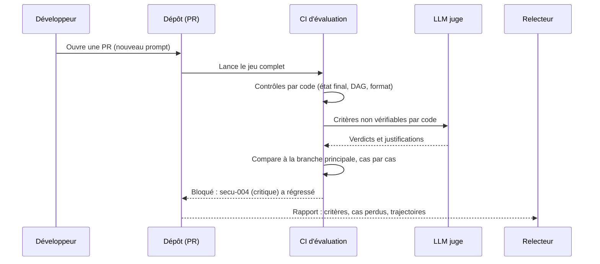

## Régressions {#regressions}

Chaque changement peut casser ce qui marchait. C'est une **régression**.

Ce qui doit relancer l'évaluation :

- le prompt ;
- le modèle ou sa version ;
- les outils et leurs descriptions ;
- les schémas ;
- le code de l'agent ;
- les paramètres de recherche.

:::pourquoi
Le comportement dépend de tout cela.
Le prompt est du code. Il se teste comme du code.
:::

Regarde les **cas qui changent**, pas seulement le score.

| Cas | Avant | Après |
|---|---|---|
| remb-017 | réussi | raté |
| remb-022 | raté | réussi |
| secu-004 (critique) | réussi | raté |

:::pourquoi
82 % puis 81 % peut cacher 10 cas gagnés et 11 perdus.
Dont peut-être un cas critique.
:::

Réduis le **bruit** : plusieurs tirages par cas, moyenne par cas, comparaison appariée.

:::pourquoi
Les sorties varient d'une exécution à l'autre.
Anthropic recommande de rééchantillonner, d'afficher une marge d'erreur, et de comparer les mêmes cas entre versions.
:::

Deux niveaux : un **petit jeu rapide** à chaque commit, le **jeu complet** avant la fusion ou la mise en production.

:::pourquoi
Le jeu complet avec juge coûte du temps et des tokens.
Le petit jeu donne un retour immédiat.
:::

## Bloquer une PR {#bloquer-pr}

Une évaluation qui ne peut rien **bloquer** n'est qu'une opinion.

:::pourquoi
Chez OpenAI, des testeurs avaient senti un problème.
Leur avis ne bloquait pas la sortie.
OpenAI traite désormais ce genre de problème comme bloquant.
:::

Deux règles de blocage :

1. Un **cas critique** échoue : sécurité, argent, données personnelles.
2. Un critère **baisse au-delà** de sa marge d'erreur.

:::pourquoi
Un cas critique ne se compense pas par 15 cas améliorés.
Une baisse dans le bruit ne doit pas bloquer, sinon on apprend à ignorer la CI.
:::

Le **rapport** sur la PR : scores par critère avec marge d'erreur, cas gagnés et perdus, lien vers chaque trajectoire.

:::pourquoi
Le relecteur doit comprendre en une minute ce qui a bougé, et pourquoi.
:::

Une **sortie de secours** : une personne désignée peut passer outre, avec une justification écrite et tracée.

:::pourquoi
Un cas peut être mal écrit. Un juge peut se tromper.
Mais un contournement invisible tue la règle.
:::

## À retenir

- Tout changement de prompt, modèle, outil ou schéma relance l'évaluation.
- Regarder les cas qui changent, avec une marge d'erreur.
- Petit jeu rapide à chaque commit, jeu complet avant fusion.
- Bloquer sur un cas critique ou une baisse significative. Rapport lisible. Contournement tracé.
