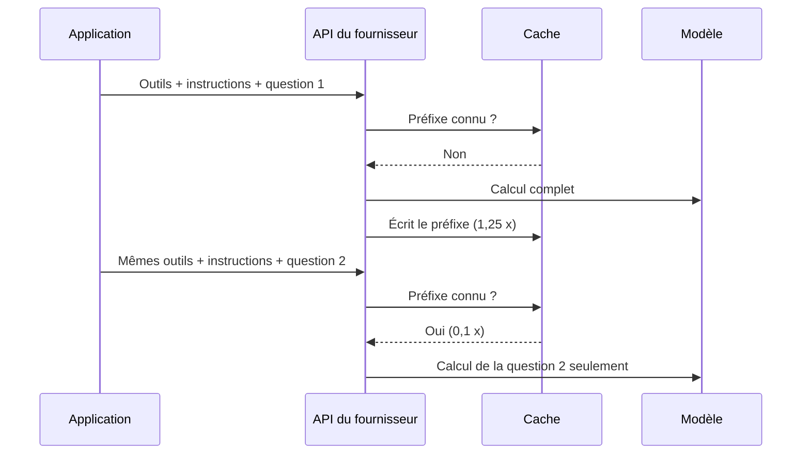
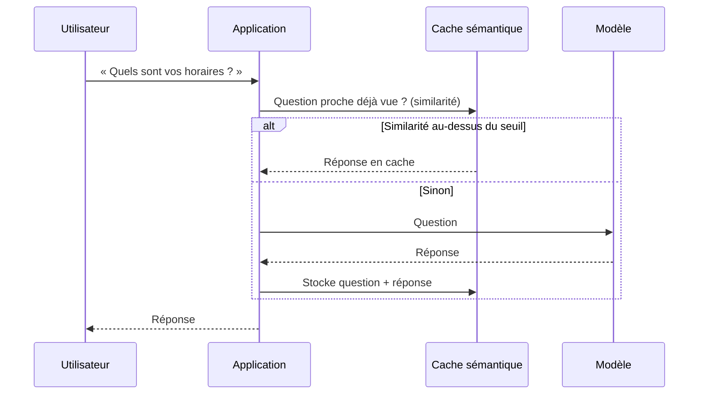

## Cache de prompt {#cache-prompt}

Beaucoup de requêtes commencent pareil : mêmes outils, mêmes instructions, mêmes documents.

Le **cache de prompt** garde le calcul fait sur ce début. La requête suivante le reprend.

:::pourquoi
Le début du prompt est souvent le plus long.
Le recalculer à chaque fois coûte du temps et de l'argent.
La réponse, elle, reste générée à neuf.
:::

Le cache marche par **préfixe exact**. Le stable d'abord, le variable à la fin.

:::pourquoi
Le cache s'arrête au premier caractère différent.
Chez Anthropic, l'ordre est : outils, puis système, puis messages.
Changer un outil invalide tout ce qui suit.
:::

| Place | Contenu |
|---|---|
| Début | Outils, instructions, documents de référence |
| Milieu | Historique de la conversation |
| Fin | Question du moment, date, heure |

Les prix chez Anthropic, pour la plupart des modèles :

| Opération | Prix par rapport au prix normal |
|---|---|
| Écriture, cache de 5 minutes | 1,25 x |
| Écriture, cache d'une heure | 2 x |
| Lecture | 0,1 x |

:::pourquoi
Deux appels sans cache : 2.
Avec cache : 1,25 + 0,1 = 1,35.
Le gain commence dès la deuxième utilisation.
:::

Chaque lecture **rafraîchit** le cache de 5 minutes. Les prompts trop courts ne sont pas mis en cache.

:::pourquoi
Un trafic régulier garde le cache chaud.
Sous une longueur minimale, le gain ne vaut pas la gestion.
La longueur minimale dépend du modèle.
:::

Chez OpenAI, le cache est **automatique** au-delà d'une longueur minimale. La remise dépend du modèle.

:::pourquoi
Rien à activer. Mais la même règle s'applique :
un préfixe stable, ou pas de remise.
Le champ `cached_tokens` de la réponse dit ce qui a été relu.
:::

Un cache partagé entre utilisateurs peut **fuir** par le temps de réponse.

:::pourquoi
Un préfixe en cache répond plus vite.
Un attaquant peut tester un début de prompt et chronométrer.
En 2025, Gu et al. ont détecté un cache partagé entre utilisateurs chez sept fournisseurs.
:::

## Cache sémantique et ses risques {#cache-semantique}

Le **cache sémantique** va plus loin. Il garde des réponses entières.

Si une question est assez proche d'une ancienne, il renvoie l'ancienne réponse. Sans appeler le modèle.

:::pourquoi
Pas d'appel au modèle : coût quasi nul, réponse immédiate.
Utile pour les questions fréquentes, comme une FAQ.
:::

Premier risque : le **faux positif**. Une question proche n'est pas la même question.

| Question en cache | Nouvelle question | Problème |
|---|---|---|
| Comment activer la 2FA ? | Comment désactiver la 2FA ? | Sens inverse |
| Statut de la commande 512 ? | Statut de la commande 513 ? | Autre commande |
| Prix en 2025 ? | Prix en 2026 ? | Autre année |

:::pourquoi
Les vecteurs de ces phrases sont très proches.
Un seul mot change le sens.
Le cache ne lit pas : il mesure une distance.
:::

Deuxième risque : la **fuite**. « Quel est mon solde ? » n'a pas la même réponse pour tout le monde.

:::pourquoi
Un cache global renvoie la réponse du premier utilisateur au suivant.
C'est une fuite de données personnelles.
:::

Troisième risque : la réponse **périmée**. Un prix, un stock ou un statut change.

:::pourquoi
La réponse en cache était juste hier.
Elle est fausse aujourd'hui, et le cache ne le sait pas.
:::

Les règles :

- Mettre en cache seulement le **général et stable** : pas de données personnelles, pas d'action.
- **Cloisonner** par utilisateur ou par client.
- Fixer une **durée de vie** et pouvoir **purger** une entrée.
- Régler le **seuil** sur des paires de questions étiquetées.

:::pourquoi
Une mauvaise réponse en cache se répète à chaque visite.
Le seuil se règle comme une évaluation : en comptant les erreurs.
:::

## À retenir

- Cache de prompt : stable d'abord, variable à la fin. Rentable dès la deuxième utilisation.
- Pas d'horodatage en tête du prompt.
- Cache sémantique : rapide et gratuit, mais faux positifs, fuites et réponses périmées.
- Cloisonner, limiter dans le temps, régler le seuil sur des données réelles.
