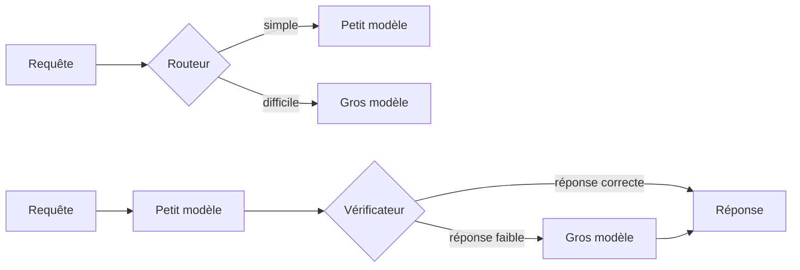
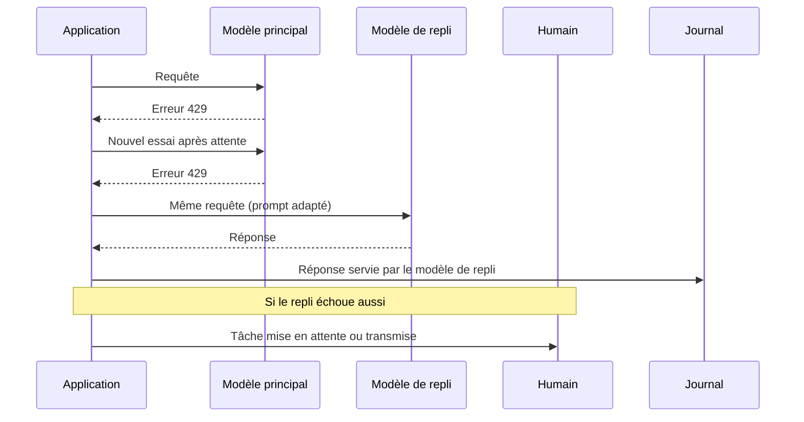

## Selon la complexité {#selon-complexite}

Toutes les requêtes ne se valent pas. Le **routage** envoie chacune au modèle le moins cher qui la traite bien.

:::pourquoi
Classer un e-mail ne demande pas le plus gros modèle.
Payer le gros modèle pour tout, c'est payer la difficulté sur chaque requête facile.
:::

| Tâche | Modèle |
|---|---|
| Classer, extraire, reformuler | Petit |
| Répondre à partir de documents fournis | Moyen |
| Planifier, raisonner longtemps, coder sur plusieurs fichiers | Gros |

Deux façons de router :

- Le **routeur** décide **avant**, à partir de la requête.
- La **cascade** décide **après**, à partir de la réponse du petit modèle.

:::pourquoi
RouteLLM (2024) apprend un routeur sur des préférences humaines.
Sur MT Bench, il garde 95 % de la performance de GPT-4 avec 26 % des requêtes envoyées à GPT-4.
FrugalGPT (2023) décrit la cascade et annonce jusqu'à 98 % d'économies au niveau de GPT-4 sur ses tests.
:::

Une cascade a un **coût caché**.

:::pourquoi
Une requête qui monte paie deux modèles et attend deux fois.
Si beaucoup montent, la cascade coûte plus que le gros modèle seul.
On suit le taux de montée.
:::

Le routage s'**évalue** branche par branche.

:::pourquoi
Une économie qui casse des réponses n'en est pas une.
Le jeu de test de l'étape 7 dit si le petit modèle tient sa branche.
:::

## Chaînes de repli {#repli}

Un fournisseur tombe en panne. Une limite de débit est atteinte. Le modèle ne répond pas.

La **chaîne de repli** prend le relais.

:::pourquoi
Sans repli, ta panne suit celle du fournisseur.
Avec repli, le service continue, peut-être un peu moins bien.
:::

Les règles :

1. **Réessayer** d'abord, avec attente croissante.
2. **Basculer** si l'erreur persiste.
3. **Échouer proprement** au bout de la chaîne.

:::pourquoi
Une erreur passagère se règle souvent en attendant.
Une chaîne sans fin devient une boucle coûteuse.
Un échec propre vaut mieux qu'une réponse inventée.
:::

Le repli sert aux **pannes**, pas aux **refus**.

:::pourquoi
Un refus de sécurité est une décision.
Le rejouer ailleurs, c'est chercher le modèle le plus permissif.
:::

Le modèle de repli passe le **même jeu de test**.

:::pourquoi
Le même prompt ne marche pas pareil sur tous les modèles.
Le repli ne sert qu'en crise : mauvais moment pour découvrir ses défauts.
:::

On **journalise** quel modèle a répondu.

:::pourquoi
Une baisse de qualité peut venir d'un repli resté actif toute la journée.
Sans trace, on cherche au mauvais endroit.
:::

## À retenir

- Router : petit modèle pour le simple, gros pour le difficile.
- Routeur avant, cascade après. Surveiller le taux de montée.
- Repli : réessayer, basculer, échouer proprement.
- Jamais de repli pour contourner un refus. Repli testé et journalisé.
