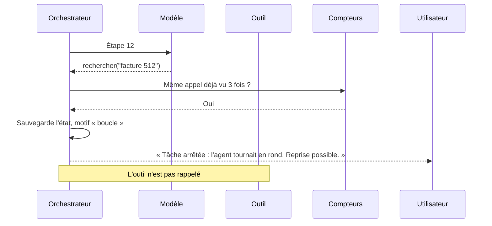

## Budgets {#budgets}

Un appel à un modèle a un coût prévisible. Un **agent**, non.

:::pourquoi
L'agent décide lui-même de rappeler le modèle.
Une boucle mal finie tourne tant qu'on ne l'arrête pas.
Chez Anthropic, un abonné à 200 dollars a consommé des dizaines de milliers de dollars de calcul.
:::

Un budget à **trois niveaux** :

| Niveau | Exemple | Ce qu'il arrête |
|---|---|---|
| Tâche | 200 000 tokens, 30 étapes, 10 minutes | Une boucle |
| Utilisateur ou client | 20 € par jour | Un abus |
| Organisation | 5 000 € par mois | Une facture hors de contrôle |

:::pourquoi
Chaque niveau arrête un problème différent.
Un seul niveau laisse passer les deux autres.
:::

Le budget d'une tâche combine plusieurs **unités** : tokens, étapes, appels d'outils, durée, argent.

:::pourquoi
Un outil payant, comme une recherche web, se compte en argent.
Une boucle d'appels courts se voit en étapes, pas en tokens.
:::

Une **alerte** avant la limite. Une **coupure** à la limite.

:::pourquoi
À 80 %, l'agent peut conclure avec ce qu'il a.
À 100 %, on coupe.
Un budget qui s'agrandit seul n'est pas un budget.
:::

## Coupure automatique {#coupure}

Certains signaux doivent **arrêter** l'agent sans attendre le budget.

| Signal | Ce qu'il révèle |
|---|---|
| Même appel d'outil, mêmes arguments, plusieurs fois | Boucle |
| Même erreur d'outil répétée | Schéma mal compris |
| Aucune progression vers le but après N étapes | Agent perdu |
| Dépense globale qui triple en une heure | Bug, boucle ou abus |

:::pourquoi
Un agent qui boucle ne progresse plus. Il consomme.
Le détecter tôt évite de payer cent fois le même échec.
:::

La coupure vit dans l'**orchestrateur**, pas dans le prompt.

:::pourquoi
Le modèle qui boucle ne sait pas qu'il boucle.
Une consigne « arrête-toi si tu boucles » ne garantit rien.
Le code compte, et coupe.
:::

Après la coupure : un **état sauvegardé**, le **motif**, un **message clair**.

:::pourquoi
L'état permet de reprendre après correction.
Le motif aide à corriger la cause.
Relancer à l'identique refait la même boucle.
:::

Au niveau de l'organisation, un **disjoncteur** suspend le non-critique et alerte une personne.

:::pourquoi
Attendre la facture, c'est payer avant de comprendre.
:::

## Quotas {#quotas}

Le **quota** borne l'usage d'un utilisateur ou d'un client sur une période.

:::pourquoi
Le budget protège ta facture.
Le quota protège aussi le service et les autres utilisateurs.
:::

Deux **fenêtres** se complètent :

| Fenêtre | Ce qu'elle arrête |
|---|---|
| Courte (minute, quelques heures) | Les rafales |
| Longue (jour, semaine) | L'usage continu |

:::pourquoi
Anthropic avait déjà une limite qui se réinitialise toutes les cinq heures.
Des agents tournaient jour et nuit, d'une fenêtre à l'autre.
La limite hebdomadaire, annoncée en juillet 2025, borne le total.
:::

Le quota vise aussi le **partage** et la **revente** d'accès.

:::pourquoi
Dix personnes sur un compte consomment comme dix.
Anthropic citait ces pratiques parmi les abus visés.
:::

Un quota atteint s'**explique** : quoi, jusqu'à quand, et l'option payante s'il y en a une.

:::pourquoi
Un quota surprise passe pour une panne.
Un quota expliqué est une règle.
:::

OWASP en fait un risque à part entière : **LLM10, Unbounded Consumption**.

:::pourquoi
Un attaquant peut saturer ton service et te faire payer la note.
Quotas et limites de débit sont la défense de base.
:::

## À retenir

- Un agent n'a pas de plafond naturel : il faut lui en donner un.
- Budgets par tâche, par utilisateur, pour l'organisation. Alerte avant, coupure à la limite.
- La coupure vit dans le code de l'orchestrateur, pas dans le prompt.
- Quotas sur deux fenêtres, expliqués à l'utilisateur.
