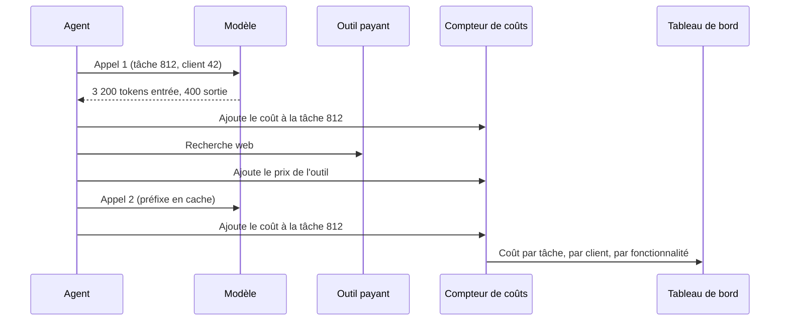

## Coût par tâche {#cout-tache}

La facture dit **combien**. Le coût par tâche dit **où** et **pourquoi**.

:::pourquoi
Une tâche qui coûte 50 fois la moyenne se noie dans la facture.
Par tâche, on voit quel flux, quel client, quel prompt coûte.
:::

Une tâche d'agent, c'est plusieurs appels. On additionne tout :

| Ligne | Exemple |
|---|---|
| Tokens d'entrée | Prompt, historique, résultats d'outils |
| Tokens lus en cache | Préfixe stable, à prix réduit |
| Tokens de sortie | Réponses, appels d'outils |
| Tokens de raisonnement | Souvent facturés comme de la sortie |
| Outils payants | Recherche web, API externe |
| Nouveaux essais | Erreurs, replis, cascade |

:::pourquoi
Oublier une ligne, c'est sous-estimer le coût.
Les essais ratés coûtent autant que les réussis.
:::

Le chiffre qui compte : le **coût par tâche réussie**.

:::pourquoi
100 tâches, 50 €, 80 réussites : 0,625 € par réussite.
Un modèle moins cher qui échoue plus peut coûter plus par réussite.
:::

Le coût d'une étape **grandit** avec l'historique.

:::pourquoi
L'étape 20 renvoie les 19 précédentes.
Le cache de prompt et le résumé de l'historique freinent cette croissance.
:::

On **étiquette** chaque appel : tâche, client, fonctionnalité.

:::pourquoi
Sans étiquette, un coût n'a pas de propriétaire.
Ces mêmes compteurs alimentent les budgets et les quotas.
:::

## Latence p50 et p95 {#latence}

La **moyenne** cache la queue. On mesure des **percentiles**.

| Mesure | Sens |
|---|---|
| p50 | La moitié des requêtes est plus rapide |
| p95 | 19 requêtes sur 20 sont plus rapides |
| p99 | 99 sur 100 sont plus rapides |

:::pourquoi
99 requêtes à 1 seconde, une à 60 secondes : moyenne 1,6 seconde.
Un utilisateur sur cent a attendu une minute.
:::

La queue **domine** quand les étapes s'enchaînent.

:::pourquoi
Dean et Barroso (2013) : une requête interroge 100 serveurs, chacun lent une fois sur 100.
Environ 63 % des requêtes tombent sur au moins un serveur lent.
Un agent qui enchaîne les appels vit le même effet.
:::

Deux mesures pour deux usages :

- **Temps jusqu'au premier token** : l'attente ressentie dans un chat.
- **Temps total** : ce qui compte pour un agent qui doit finir avant d'agir.

:::pourquoi
Avec l'affichage progressif, l'utilisateur lit dès le premier mot.
Un agent, lui, n'agit qu'une fois la réponse complète.
:::

On mesure **par étape** et **de bout en bout**.

:::pourquoi
De bout en bout : ce que vit l'utilisateur.
Par étape : où passe le temps.
Un outil lent se cache souvent derrière un modèle accusé à tort.
:::

Pour réduire la queue :

- moins d'étapes en série ;
- des étapes **en parallèle** quand elles sont indépendantes ;
- le **cache** de prompt ;
- un **petit modèle** pour les étapes simples ;
- un **délai maximal** par appel, avec repli.

:::pourquoi
Chaque étape en série ajoute son attente et son risque d'être lente.
Le cache et le petit modèle raccourcissent chaque étape.
Le délai maximal coupe la queue la plus longue.
:::

## À retenir

- Mesurer le coût par tâche réussie, toutes lignes comprises.
- Étiqueter chaque appel : tâche, client, fonctionnalité.
- Latence en p50 et p95, pas en moyenne. Par étape et de bout en bout.
- Les étapes en série font grandir la queue.
