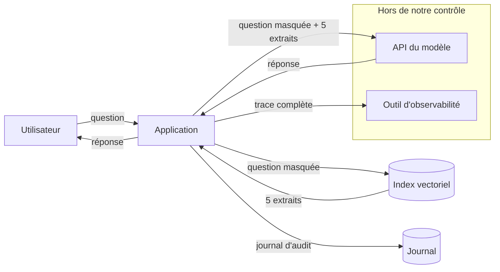
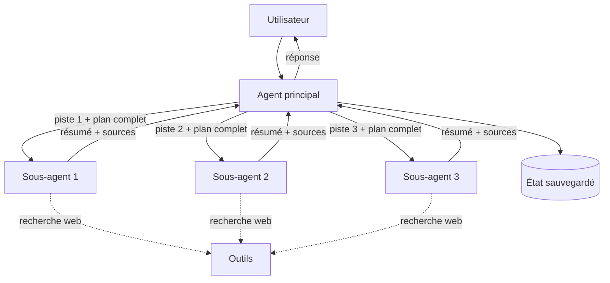

## Flux de données {#flux-donnees}

Le **flux de données** suit la donnée, pas le code : d'où elle vient, où elle passe, où elle reste.

:::pourquoi
On voit d'un coup d'œil ce qui sort de chez soi.
Chaque flèche qui traverse la frontière est une question de sécurité.
:::

Trois règles :

1. Chaque flèche porte une **étiquette** : ce qui passe.
2. Les **frontières de confiance** sont dessinées.
3. Les **copies** sont visibles : journaux, traces, caches.

:::pourquoi
Une flèche sans étiquette dit « ça parle », pas « quoi ».
La frontière montre où les règles changent.
Les traces sont une copie complète des données, souvent oubliée.
:::

Le **modèle C4** de Simon Brown propose des niveaux de zoom :

| Niveau | Montre | Pour qui |
|---|---|---|
| Contexte | Le système, ses utilisateurs, ses voisins | Tout le monde |
| Conteneurs | Applications et bases déployées à part | Équipe technique |
| Composants | Les blocs dans un conteneur | Développeurs |
| Code | Le détail d'un composant (optionnel) | Rarement utile |

:::pourquoi
Un dirigeant n'a pas besoin des composants.
Un développeur a besoin de plus que le contexte.
On choisit le zoom selon le lecteur.
:::

Les diagrammes s'écrivent en **texte** (Mermaid) et vivent **dans le dépôt**.

:::pourquoi
Ils se modifient dans la même PR que le code.
Le diff montre ce qui a changé.
Une image exportée se périme en silence.
:::

## Topologie d'agents {#topologie}

La **topologie** montre qui appelle qui, en série ou en parallèle, avec quel contexte.

:::pourquoi
La forme dit le parallélisme : branches qui partent et reviennent.
On voit qui synthétise, et ce que chacun reçoit.
:::

L'étiquette la plus importante : le **contexte transmis**.

:::pourquoi
Cognition : les sous-agents de Flappy Bird ne voyaient pas le travail de l'autre.
Leurs choix implicites se sont contredits.
Une flèche « tâche seule » annonce ce risque.
:::

Ajoute les **outils** de chaque agent et l'endroit où l'**état** est stocké.

:::pourquoi
Les outils montrent les droits : moindre privilège, étape 6.
L'état montre ce qui survit à une panne : durabilité, étape 5.
:::

Un diagramme répond à **une question**.

:::pourquoi
Flux, topologie, déploiement, coûts sur un seul schéma : personne ne lit.
Trois diagrammes clairs valent mieux qu'un seul confus.
:::

## À retenir

- Flux de données : étiquettes sur les flèches, frontières de confiance, copies visibles.
- C4 : choisir le niveau de zoom selon le lecteur.
- Topologie : qui appelle qui, en parallèle ou non, avec quel contexte.
- Diagrammes en texte, dans le dépôt. Un diagramme, une question.
