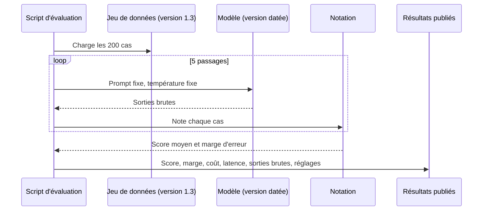

## Reproductibilité {#reproductibilite}

Un chiffre qu'on ne peut pas refaire est une **affirmation**. Un chiffre qu'on peut refaire est une **mesure**.

:::pourquoi
En avril 2025, Meta annonce Llama 4 Maverick.
Une variante « expérimentale », réglée pour la conversation, est 2ᵉ sur LMArena.
La version publique, testée ensuite, arrive 32ᵉ.
Le chiffre décrivait un modèle que personne ne pouvait télécharger.
:::

Ce qui fausse un chiffre :

| Piège | Exemple | Parade |
|---|---|---|
| Version floue | Une variante testée, une autre publiée | Version exacte, datée |
| Meilleur tirage | 27 variantes privées, une seule publiée | Dire combien d'essais |
| Test mal fait | Tâches mal décrites, tests trop stricts | Relire le jeu de test |
| Passage unique | 74 %, sans marge d'erreur | Plusieurs passages, marge d'erreur |
| Contamination | Le modèle a vu les réponses | Jeu privé ou récent |
| Conditions différentes | Deux codes d'évaluation | Mêmes conditions pour tous |

:::pourquoi
L'étude « The Leaderboard Illusion » (2025) compte 27 variantes privées testées par Meta avant Llama 4.
Garder la meilleure de 27, c'est garder le meilleur tirage.
OpenAI a créé SWE-bench Verified en 2024 : 93 développeurs ont relu 1 699 tâches pour en garder 500 claires et solubles.
:::

Le circuit d'un benchmark reproductible :



:::pourquoi
Chaque élément est fixé et versionné.
Les cinq passages donnent la marge d'erreur.
Tout ce qui sort est publié : quelqu'un d'autre peut refaire le circuit.
:::

La fiche à publier avec chaque résultat :

```yaml
modele: claude-sonnet-x-2026-05-01   # version datée, pas un alias
jeu_de_donnees: support-golden v1.3 (200 cas)
prompts: prompts/agent-v12.md
temperature: 0
max_tokens: 4096
passages: 5
code_evaluation: eval/run.py @ commit 3f2a91c
score: 74 % ± 3 %
cout_par_tache: 0,18 €
latence_p95: 11 s
sorties_brutes: resultats/2026-11-19/
date: 2026-11-19
```

:::pourquoi
Chaque ligne change le résultat si elle change.
Un prompt différent peut faire bouger le score de plusieurs points.
Le coût et la latence évitent de vanter un agent trop cher.
:::

Une comparaison n'est honnête que dans les **mêmes conditions**.

:::pourquoi
Un code d'évaluation peut être plus généreux qu'un autre.
Deux chiffres mesurés différemment ne se comparent pas.
:::

## À retenir

- Version exacte du modèle, prompts, réglages, jeu de données, code : tout est publié.
- Plusieurs passages, une marge d'erreur, le nombre d'essais avant le chiffre.
- Le coût, la latence et les sorties brutes avec le score.
- Mêmes conditions pour comparer. Attention à la contamination.
