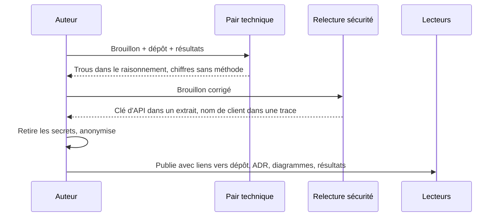

## Analyse de son architecture {#analyse-architecture}

Le code montre **ce qui** a été fait. L'analyse montre **pourquoi**, et **à quel prix**.

:::pourquoi
Un recruteur ou un pair veut voir ton jugement.
Le jugement se voit dans les choix et les compromis, pas dans la liste d'outils.
:::

Le plan :

| Section | Contenu |
|---|---|
| Problème et contraintes | Ce qu'il fallait résoudre, avec quel budget, quelle latence, quelles données |
| Architecture | Flux de données et topologie d'agents |
| Décisions | Les choix clés, les options écartées, liens vers les ADR |
| Mesures | Qualité, coût, latence, avec la méthode |
| Échecs | Ce qui n'a pas marché, et pourquoi |
| Ce que je changerais | Avec les raisons |

:::pourquoi
Les contraintes expliquent les choix.
Les options écartées prouvent qu'il y a eu un choix.
Les échecs et le « je changerais » montrent le recul.
:::

Donne le **prix** avec le **gain**.

:::pourquoi
Anthropic annonce +90,2 % pour son multi-agent.
Il écrit aussi : environ 15 fois plus de tokens, et des tâches où ça convient mal.
C'est ce qui rend l'article crédible.
:::

Raconte les **échecs**.

:::pourquoi
Cognition bâtit son article sur Flappy Bird raté.
OpenAI publie ce qu'il a manqué avec GPT-4o.
Un article sans échec fait douter des tests.
:::

Chaque chiffre vient avec sa **méthode** : jeu de test, nombre de cas, passages, marge d'erreur, version du modèle.

:::pourquoi
« 92 % » sur 20 cas et un passage ne vaut pas « 92 % » sur 2 000 cas et cinq passages.
Le lecteur doit pouvoir juger.
:::

Avant de publier, deux relectures :

:::pourquoi
Un pair voit ce que l'auteur ne voit plus.
Une clé publiée se vole en minutes.
Ce qui est publié ne se retire jamais complètement.
:::

On retire : **clés d'API**, **données de clients**, **noms internes sensibles**, **prompts** qui révèlent des secrets.

:::pourquoi
Une trace d'agent peut contenir des données personnelles.
On publie le raisonnement, pas les secrets.
:::

Un **titre** qui annonce une décision et son compromis.

| Moins bien | Mieux |
|---|---|
| « Mon super projet IA » | « Un agent unique plutôt que trois : 2,8 fois moins cher » |
| « Utilisation de LangChain et Pinecone » | « Pourquoi notre cache sémantique renvoyait la mauvaise réponse » |

:::pourquoi
Le titre dit au lecteur ce qu'il va apprendre.
Une liste d'outils ne dit rien du raisonnement.
:::

Tout le chapitre converge ici : l'article **résume**, le dépôt **prouve**.

:::pourquoi
Les ADR donnent les décisions.
Les diagrammes donnent la structure.
Les résultats d'évaluation permettent de refaire la mesure.
:::

## À retenir

- Problème, architecture, décisions, mesures, échecs, ce que je changerais.
- Le prix avec le gain. Les échecs avec les succès.
- Chaque chiffre avec sa méthode.
- Relecture technique et sécurité. Liens vers le dépôt, les ADR, les résultats.
